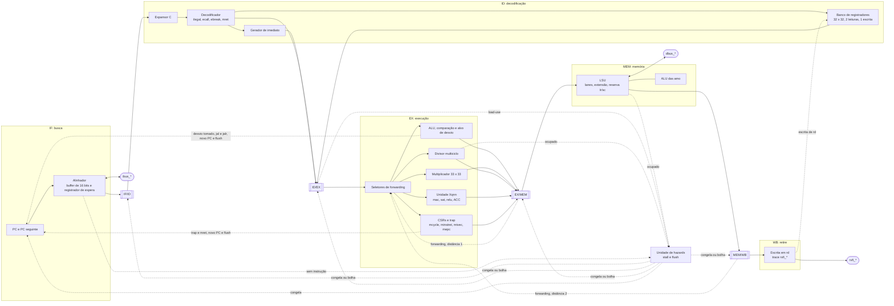

# Especificação da arquitetura e da ISA estendida

Contrato entre o núcleo em RTL (`rtl/`), o modelo de referência (`model/`), o ambiente de verificação (`tb/`) e a biblioteca de software (`sw/`). Tudo o que esses quatro precisam concordar entre si está escrito aqui e em nenhum outro lugar. Nada de RTL, ISS ou intrínseco definitivo antes da versão 1.0 aprovada (meta M2.1, checklist em `docs/checklist.md`).

Responsável: Lucas Lares (A). Revisão: Pedro Piccichelli (B) e Lucas Teixeira (C). Aprovação: os três integrantes e o orientador. A cada versão aprovada é criada a tag `spec-vX.Y` na `main` (ver `docs/convencoes.md`, seção 5). Mudanças depois da 1.0 seguem a seção 7.1 do plano de trabalho e são registradas em `docs/decisoes.md`.

Última atualização: 2026-11-16. Situação: rascunho, versão 0.14, não aprovada.

Convenção deste documento: cada seção começa dizendo o que define e termina com a lista "A decidir", com os pontos ainda abertos. Quando uma seção não tiver mais nada em "A decidir", ela está pronta para revisão.

## 1. Escopo

Define o que o processador implementa, o que fica fora, o que é parametrizável, a referência de conformidade e a ordem de corte de escopo. Decisão D9 em `docs/decisoes.md`.

### 1.1 O que está dentro

Um núcleo RISC-V de 32 bits, único (um hart), em ordem, em pipeline de cinco estágios (seção 5), sem cache, com memória Harvard (seção 2), que implementa:

| Extensão | Conteúdo | Habilitação |
|---|---|---|
| RV32I | As 40 instruções do conjunto base de inteiros, versão 2.1, incluindo `fence`, `ecall` e `ebreak`. | sempre |
| M | `mul`, `mulh`, `mulhsu`, `mulhu`, `div`, `divu`, `rem`, `remu` (seção 6). | parâmetro |
| A | `lr.w`, `sc.w` e as nove `amo*.w` (seção 7). | parâmetro |
| C | Todas as instruções RV32C que não dependem de ponto flutuante (seção 8). | parâmetro |
| Zicsr | `csrrw`, `csrrs`, `csrrc`, `csrrwi`, `csrrsi`, `csrrci`, sobre os CSRs da seção 9.1. | sempre |
| `Xqnn` | `mac`, `sat` e `relu` sobre o opcode `custom-0`, mais o CSR `macacc` (seção 4). | parâmetro |
| Privilegiada | Modo máquina apenas, com o mecanismo de trap, `mret`, `wfi` e os CSRs da seção 9. | sempre |

`Xqnn`, de quantized neural network, é o nome da extensão custom, no formato que a ISA reserva para extensões não padrão: `X` seguido de letras minúsculas. Neste documento, "extensão custom", "unidade custom" e `Xqnn` são a mesma coisa; o corpo do texto usa `Xqnn`. O nome aparece no bit `X` do `misa` (seção 9.1), no parâmetro de habilitação `EN_XQNN` (seção 12), no nome do módulo em Verilog, `xqnn_unit`, dentro de `core_top`, e na documentação. A toolchain não o conhece: o software emite as instruções com `.insn` (seção 4.1).

### 1.2 O que está fora

Fora do escopo de propósito, não por esquecimento. Cada item traz o motivo ou a seção que o justifica:

- Interrupções e temporizador (`mtime`, `mtimecmp`): não há fonte de interrupção no sistema simulado; `mie` e `mip` leem zero (seção 9).
- Modos supervisor e usuário, e o que vem com eles: `medeleg`, `mideleg`, `mcounteren`, PMP, memória virtual, `sret`, `sfence.vma`. Só modo máquina (seção 9).
- Modo de depuração (`dret`, Debug Module).
- Ponto flutuante (F, D), extensão B, extensão V e qualquer outra extensão padrão fora de M, A, C e Zicsr.
- Zifencei (`fence.i`): a memória de instruções não é escrita pelo programa (seção 2); `fence.i` é instrução ilegal (seção 9).
- Zicntr e Zihpm: as sombras `cycle`, `time` e `instret` e os contadores de desempenho; o software usa `mcycle` e `minstret` (seção 9).
- Acesso a dados desalinhado atendido pelo hardware: gera exceção (seções 9 e 10).
- Caches, buffer de escrita, predição dinâmica de desvio, execução fora de ordem.
- Barramento padrão (AXI, OBI): a interface é a da seção 10; a adaptação é trabalho futuro.
- Prototipação em FPGA e síntese para silício: toda a validação é em simulação. A síntese lógica genérica da M2.5 é opcional e só para estimativa de recursos.
- Mais de um núcleo: a atomicidade da extensão A vem de haver um só mestre (seção 10).

### 1.3 O que é parametrizável

Vetor de reset, tamanho da IMEM e da DMEM, habilitação individual de M, A, C e `Xqnn`, e os wait states das memórias padrão. Nomes, tipos e valores padrão na seção 12. Com uma extensão desligada, suas instruções são ilegais e o bit correspondente do `misa` lê zero (seção 9).

### 1.4 Referência e conformidade

A ISA de referência é a do RISC-V Instruction Set Manual: Volume I, não privilegiado, versão 20191213, e Volume II, privilegiado, versão 20211203, as mesmas citadas no plano de trabalho. Onde a ISA deixa escolha ao projetista (acesso desalinhado, `mtval`, `wfi`, CSRs opcionais, codificações do `custom-0`), a escolha está nesta especificação.

Conformidade do subconjunto padrão: a suíte `riscv-tests`, grupos `rv32ui`, `rv32um`, `rv32ua` e `rv32uc`, adaptada ao mapa de memória e ao `tohost` (M4.1), aprovada no RTL (M2.2 e M2.3) e no ISS (M3.2), com o ISS também comparado ao Spike. Ressalvas:

- `fence_i` fica fora: Zifencei fora do escopo (seção 2).
- `ma_data`, do `rv32ui`, exercita acessos desalinhados. Como aqui eles geram exceção, a M4.1 verifica se o teste aceita o trap com os códigos 4 e 6 (seção 9.2); se aceitar, entra; se não, fica fora como o `fence_i`, com registro em `docs/decisoes.md`.

As instruções `Xqnn` não têm suíte externa: são verificadas contra o ISS, contra a implementação independente em C (seção 4) e contra os vetores de referência da CNN (M4.3), conforme o plano de verificação da M3.3.

### 1.5 Ordem de corte de escopo

Se for preciso cortar, a ordem de prioridade é a da seção 7.3 do plano de trabalho, do que fica até o fim ao que sai primeiro:

1. Núcleo RV32I com a extensão `Xqnn`, verificado. É o essencial e não é cortado.
2. Extensões M e A.
3. Aplicação de demonstração comparativa (M4.4).
4. Extensão C e otimizações.

Todo corte é uma mudança de escopo: issue, linha na seção 3 de `docs/decisoes.md` e aprovação do orientador (plano, seção 7.1). A extensão C já tem o ponto de decisão marcado para a revisão de riscos da semana 11 (risco R2).

A decidir: nada. Seção pronta para revisão.

## 2. Mapa de memória e periféricos

O endereço de 32 bits é decodificado pelos quatro bits mais altos, `addr[31:28]`, que escolhem a região. Dentro da região, os bits baixos endereçam a palavra; quantos bits são usados depende do tamanho configurado (seção 12).

| Região | `addr[31:28]` | Base | Tamanho padrão | Porta | Acesso |
|---|---|---|---|---|---|
| IMEM | `0x0` | `0x0000_0000` | 64 KiB | Instruções | Só busca de instruções |
| DMEM | `0x1` | `0x1000_0000` | 128 KiB | Dados | Leitura e escrita de 8, 16 e 32 bits |
| Periféricos | `0x2` | `0x2000_0000` | 4 palavras, fixo | Dados | Palavras de 32 bits com byte enables (ver abaixo) |
| Demais | `0x3` a `0xF` | | | | Fora do mapa |

Regras:

- **Harvard estrita.** A porta de instruções enxerga só a IMEM; a porta de dados enxerga só a DMEM e os periféricos. Para o software (M4.1), o linker script põe `.text` na IMEM e `.rodata`, `.data` e `.bss` na DMEM. Como o testbench e o ISS carregam os dois `.hex` antes do reset, o `crt0` não copia `.data`; só zera `.bss`. Consequência para a verificação: o teste `fence_i` dos `rv32ui` escreve na memória de instruções e fica fora da suíte (Zifencei não está no escopo).
- **Tamanhos parametrizáveis.** IMEM e DMEM são parâmetros do topo (seção 12) com os padrões da tabela, iguais no RTL e no ISS. O tamanho é sempre potência de dois.
- **DMEM de 128 KiB.** O plano propôs 64 KiB; 128 KiB é a menor potência de dois que comporta a demonstração com 100 imagens residentes, conforme o orçamento abaixo. Decisão D2 em `docs/decisoes.md`.
- **Fora do mapa.** Acesso a uma região não mapeada, além do tamanho configurado da IMEM ou da DMEM, ou além das 4 palavras dos periféricos: a leitura devolve 0 e a escrita é ignorada, no RTL e no ISS, sem exceção, porque a interface de memória não tem sinal de erro (seção 10) e a seção 9 não define exceções de acesso. O testbench acusa qualquer acesso desses como erro do teste. Uma busca de instrução fora do mapa devolve a palavra zero, que é instrução ilegal (seção 9): um salto para o nada vira trap.

Orçamento da DMEM para a demonstração MNIST (estimativas; a M4.3 confirma os valores da rede):

| Conteúdo | Tamanho |
|---|---|
| 100 imagens de 28 × 28 em int8 | 78.400 B |
| Pesos e vieses da CNN (poucos milhares de parâmetros) | ~6 KiB |
| Ativações em int8, requantizadas a cada saída (sem buffer int32) | ~10 KiB |
| `.data`, `.bss` e pilha | ~8 KiB |
| Total | ~101 KiB de 128 KiB |

Os vetores de referência camada a camada (cerca de 9 KiB por imagem) não cabem para as 100 imagens; a comparação camada a camada da M4.4 é feita em poucas imagens ou fora do processador, a partir da memória lida pelo testbench.

Periféricos. Cada registrador se comporta como uma palavra de memória de 32 bits com byte enables, e o efeito colateral acontece em toda escrita que habilite o byte 0:

| Endereço | Nome | Leitura | Escrita |
|---|---|---|---|
| `0x2000_0000` | `console` | Retorna 0 | O byte `[7:0]` é impresso como um caractere pelo testbench e pelo ISS |
| `0x2000_0004` | `tohost` | Retorna o último valor escrito (0 após o reset) | Com bit 0 = 1, encerra a simulação com código `valor >> 1`; o valor `1` é sucesso. Com bit 0 = 0, só armazena |
| `0x2000_0008`, `0x2000_000C` | reservados | Retorna 0 | Ignorada |

O protocolo do `tohost` é o dos `riscv-tests` e do Spike: `RVTEST_PASS` escreve `1` e `RVTEST_FAIL` escreve `(número_do_teste << 1) | 1`. Os fontes dos testes rodam sem alteração no RTL, no ISS e no Spike, com o mesmo código de término; o que a M4.1 adapta é o ambiente, linker script e `riscv_test.h` (seção 1.4). O Spike não tem o `console` neste endereço; a M4.1 decide como os programas imprimem lá.

Não há espelhos dos contadores nos periféricos: o software lê `mcycle` e `minstret` com `csrr` (seção 9), como a HAL da M4.1 já prevê. Decisão D4 em `docs/decisoes.md`.

A decidir: nada. Seção pronta para revisão.

## 3. Reset e término

Define o estado do processador após o reset e como um programa sinaliza que terminou, para o testbench e o ISS começarem iguais e encerrarem na mesma instrução, com o mesmo código. Decisão D9 em `docs/decisoes.md`.

### 3.1 Reset

O reset é o `rst_n` da seção 10: síncrono, ativo em nível baixo. O núcleo entra em reset em qualquer borda de subida de `clk` com `rst_n = 0`; uma borda basta, mas o testbench padrão segura o reset por vários ciclos, e o núcleo não depende de quantos. Enquanto `rst_n = 0`, `ibus_valid` e `dbus_valid` ficam em 0, nenhuma instrução está em voo e nenhum estado muda. No primeiro ciclo com `rst_n = 1`, o núcleo emite a busca no vetor de reset e `mcycle` vale 0; `mcycle` incrementa ao fim de cada ciclo daí em diante.

Estado após o reset:

| Estado | Valor | Definido em |
|---|---|---|
| PC | vetor de reset: `0x0000_0000` por padrão, parâmetro | seção 12 |
| `x1` a `x31` | 0 | esta seção |
| CSRs | 0 em `mtvec`, `mepc`, `mcause`, `mtval`, `mscratch`, `mcycle`/`mcycleh` e `minstret`/`minstreth`; `mstatus` lê `0x0000_1800`, isto é, `MIE = 0`, `MPIE = 0` e `MPP` fixo em `11`; `misa` e os de identificação são constantes | seção 9.1 |
| `ACC` (`macacc`) | 0 | seção 4.2 |
| Reserva de `lr.w`/`sc.w` | inválida | seção 7 |
| Pipeline, buffer de busca e registrador de espera do IF | vazios | seções 5 e 8 |
| IMEM e DMEM | não são afetadas pelo reset. O testbench e o ISS as carregam dos `.hex` antes de soltar o reset; `.rodata` e `.data` já estão na DMEM quando o programa começa | seção 2 |
| `tohost` | 0; o `console` não tem estado | seção 2 |

O banco de registradores é zerado no reset, e o ISS faz o mesmo. Uma SRAM real acordaria com conteúdo indefinido, mas em simulação registrador não inicializado vale X, enquanto no ISS vale 0: qualquer leitura antes de escrita, por exemplo num programa aleatório da M3.3, divergiria no scoreboard sem haver defeito, e o X poderia se espalhar pelo pipeline e poluir o trace. Zerar custa um reset em 31 registradores e elimina essa fonte de ruído. Com `mtvec = 0`, um trap antes de o software programá-lo salta para o endereço 0, que coincide com o vetor de reset só na configuração padrão; por isso o `crt0` escreve `mtvec` antes de tudo (seção 9.3).

### 3.2 Término

Um programa termina escrevendo no `tohost` (`0x2000_0004`, seção 2) um valor com o bit 0 em 1: `1` é sucesso, `(código << 1) | 1` é falha, e o código de saída da simulação é `valor >> 1`. É o protocolo dos `riscv-tests` e do Spike. O `console` (`0x2000_0000`) imprime e não encerra nada.

- O núcleo não participa do término. O `tohost` é um periférico do `soc_top`; o núcleo não sabe que ele existe e continua buscando e executando depois da escrita.
- O programa, logo depois da escrita, entra num laço infinito (`1: j 1b`). É o que os `riscv-tests` fazem e o que o `crt0` da M4.1 faz no retorno do `main`, usando o valor de retorno como código. Assim o comportamento continua definido e sem efeitos colaterais enquanto a simulação não parar.
- O testbench e o ISS encerram no retire da instrução de store que escreveu no `tohost`. Esse retire aparece no trace com `rvfi_mem_addr = 0x2000_0004` e `rvfi_mem_wmask` incluindo o byte 0 (seção 11), é comparado normalmente e é o último comparado. Como os dois param na mesma instrução, não há "depois" para divergir.
- Nenhuma outra coisa encerra a simulação. `ebreak`, `ecall` e instrução ilegal geram trap (seção 9), e é o tratador que decide, normalmente escrevendo no `tohost` com código de falha. Um limite de ciclos do testbench, para programa que travou, é falha do teste, não término.

A decidir: nada. Seção pronta para revisão.

## 4. Instruções `Xqnn`

As três instruções para redes neurais quantizadas: `mac`, `sat` e `relu`. Esta seção é a base para o RTL (M2.4), o ISS (M3.2), os intrínsecos (M4.2) e os covergroups (M3.3). A codificação e a semântica partem da tabela 4.1.3 do plano de trabalho; o que o plano deixou em aberto é fechado aqui.

### 4.1 Codificação

Formato R-type sobre o opcode `custom-0`, que a especificação RISC-V reserva para extensões do projetista e garante que nenhuma extensão padrão usa. Os campos `funct3` e `funct7` distinguem as instruções; `funct7` é zero nas três.

| Bits | 31:25 | 24:20 | 19:15 | 14:12 | 11:7 | 6:0 |
|---|---|---|---|---|---|---|
| Campo | `funct7` | `rs2` | `rs1` | `funct3` | `rd` | `opcode` |

| Mnemônico | Sintaxe | `funct3` | `funct7` | `opcode` | Equivalente em `.insn` |
|---|---|---|---|---|---|
| `mac` | `mac rd, rs1, rs2` | `000` | `0000000` | `0001011` (`0x0B`) | `.insn r 0x0B, 0x0, 0x00, rd, rs1, rs2` |
| `sat` | `sat rd, rs1, rs2` | `001` | `0000000` | `0001011` | `.insn r 0x0B, 0x1, 0x00, rd, rs1, rs2` |
| `relu` | `relu rd, rs1` | `010` | `0000000` | `0001011` | `.insn r 0x0B, 0x2, 0x00, rd, rs1, x0` |

Regras comuns às três:

- Os mnemônicos existem nesta especificação, no trace do ISS e na documentação. O assembler GNU não os conhece; o software emite as instruções com a diretiva `.insn r` (M4.2) e o `objdump` as mostra como palavras cruas, decodificadas pelo script da M4.2.
- `rd = x0`: a escrita em `rd` é descartada, como em qualquer R-type. Para `sat` e `relu` a instrução não tem efeito arquitetural; para `mac` o acumulador é atualizado mesmo assim (4.2). Em todos os casos a instrução é retirada e contada em `minstret`.
- `funct3` de `011` a `111` e qualquer `funct7` diferente de zero são reservados. Uma instrução com opcode `custom-0` e campos reservados é instrução ilegal e gera a exceção correspondente (seção 9), nunca `nop`: um `.insn` digitado errado no software falha na hora, em vez de passar em silêncio, e o espaço de codificação fica livre para extensões futuras, porque nenhum programa pode depender de um `nop`. Decisão D7 em `docs/decisoes.md`.

### 4.2 `mac`: multiplicação e acumulação

A unidade `Xqnn` tem um registrador interno de 32 bits, o acumulador `ACC`, zerado no reset. O software o enxerga como o CSR `macacc`, endereço `0x7C0`, dentro da faixa `0x7C0` a `0x7FF` que a especificação RISC-V reserva para CSRs do projetista em modo máquina, com leitura e escrita pelas instruções Zicsr padrão.

```
ACC ← (ACC + rs1 × rs2) mod 2^32
rd  ← ACC                         (valor novo)
```

- `rs1` e `rs2` são palavras de 32 bits; a `mac` não lê `rd`. O resultado são os 32 bits menos significativos da soma. Os 32 bits baixos de um produto não dependem de os fatores serem lidos com ou sem sinal, então não há variante com e sem sinal.
- Overflow: wrap-around, sem flag e sem exceção. Com o `ACC` valendo `a`, `mac rd, rs1, rs2` deixa em `rd` e no `ACC` exatamente o valor de `mul t, rs1, rs2` seguido de `add rd, a, t` da extensão M. É essa equivalência que permite comparar bit a bit as versões `baseline` e `ext` da aplicação: a saturação nunca é implícita, só pela `sat`.
- `rd = x0`: a cópia para `rd` é descartada, mas o `ACC` é atualizado mesmo assim. É o uso normal no laço interno, quando só o acumulado importa.
- Zerar, ler e carregar o acumulador: `csrwi 0x7C0, 0`, `csrr rd, 0x7C0` e `csrw 0x7C0, rs1`. São instruções Zicsr que o assembler GNU já aceita com o endereço numérico; não há instrução custom nova.
- Um só acumulador: uma acumulação por vez. A aplicação calcula um elemento de saída de cada vez; para intercalar duas acumulações, o software salva e restaura o `ACC` com `csrr` e `csrw`.
- O compilador não conhece o `ACC`. O software zera o `ACC` no início de cada acumulação e não supõe que ele sobreviva a chamadas de função. Os intrínsecos da M4.2 usam `asm volatile` na `mac` e nos acessos ao `ACC`, para o compilador não os reordenar, duplicar nem eliminar (risco R7).
- Referência em C (M4.2), com `acc` representando o `ACC`: `acc = (uint32_t)acc + (uint32_t)a * (uint32_t)b; rd = (int32_t)acc;`. Aritmética sem sinal para o overflow não ser comportamento indefinido em C.
- Na aplicação, a soma de produtos int8 × int8 fica longe de 2^31: um filtro 3 × 3 sobre 16 canais soma 144 produtos de módulo até 2^14, menos de 2^22, mais um viés. O wrap-around existe para a semântica ser completa e determinística, não porque ocorra em uso normal.

Efeitos no pipeline. O plano (seção 4.1.3) deixou em aberto como a `mac` acessa o acumulador. Decisão: **acumulador dedicado na unidade `Xqnn`, exposto como CSR**, registrada como D3 em `docs/decisoes.md`.

- O banco de registradores continua com duas portas de leitura e uma de escrita. A `mac` lê `rs1` e `rs2` como qualquer R-type e escreve `rd` pelo caminho normal de WB, participando do forwarding como produtora.
- O `ACC` fica na unidade `Xqnn`, no estágio EX. A `mac` lê o `ACC` e o escreve na borda de relógio do mesmo ciclo em EX, então `mac` consecutivas se encadeiam sem forwarding nem stall.
- Os acessos ao `ACC` pelas instruções Zicsr também executam em EX, em ordem de programa, logo não há hazard entre `csrw`, `csrr` e `mac` além do que a ordem do pipeline já garante.
- A escrita do `ACC` acontece no EX quando a instrução é válida e o estágio avança (seções 5.3 e 5.6). Como o trap é tomado no EX pela própria instrução e o flush só atinge IF e ID, nada mais velho anula uma instrução que já está no EX; uma bolha ou uma casca de trap no EX não escreve o `ACC`.
- Requisito para a seção 6, atendido: a latência da `mac` é a da `mul`, um ciclo (seção 6.1), e `mac` consecutivas nunca param. A unidade `Xqnn` tem o próprio multiplicador, de 32 × 32 para 32 bits (seção 6.3). A alternativa com multiplicador de dois ciclos, em que a `mac` faria o produto no primeiro e a soma no `ACC` no segundo e `rd` ficaria pronto um estágio depois, como um load, foi descartada em D11.
- Motivo da escolha e alternativas descartadas: D3.

### 4.3 `sat`: saturação

Força `rs1` a caber em `n` bits com sinal, com `n = rs2[4:0]`. Decisão D7 em `docs/decisoes.md`.

```
n ← rs2[4:0]
se n = 0:   rd ← rs1                                    sem saturação: n vale como 32
senão:      rd ← clamp(rs1, −2^(n−1), 2^(n−1) − 1)      comparação com sinal
```

- `rs1` é tratado como inteiro de 32 bits com sinal. Para `n = 8`, o resultado fica entre −128 e 127; para `n = 16`, entre −32768 e 32767; para `n = 1`, entre −1 e 0; para `n = 31`, entre −2^30 e 2^30 − 1.
- A largura vem de um registrador, e não de um imediato, para as três instruções terem o mesmo formato R-type e para `n` poder variar em tempo de execução, lido de uma tabela por camada, sem recompilar. O `li` que carrega `n` fica fora do laço e executa uma vez por camada; ler `rs2` não custa nada, porque o R-type já lê dois fontes.
- `n = 0` é identidade: equivale a `n = 32`, e nenhum valor de 32 bits é cortado. Dá um modo "sem saturação" selecionável em tempo de execução, e em hardware sai de graça, porque os limites viram os do próprio int32.
- `rs2[31:5]` é ignorado, como as instruções de deslocamento da ISA ignoram os bits altos de `rs2`. Esses bits não são reservados: um valor diferente de zero neles não gera exceção.
- `rd = x0`: sem efeito (4.1). A `sat` não lê `rd`; `rs1` e `rs2` são os dois fontes informados no trace (seção 11).
- Implementação no RTL: `rs1` cabe em `n` bits com sinal exatamente quando os bits `rs1[31:n−1]` são todos iguais ao bit de sinal `rs1[31]`. Se cabem, `rd = rs1`; se não, `rs1[31]` escolhe o limite: 1 leva a `−2^(n−1)`, 0 leva a `2^(n−1) − 1`. Um ciclo, sem comparador de 32 bits. O ISS implementa pela comparação direta com os dois limites, de propósito, para as duas implementações não compartilharem o mesmo raciocínio (risco R3).
- Referência em C (M4.2 e implementação independente), sem comportamento indefinido:

```c
static inline int32_t sat_ref(int32_t x, uint32_t n) {
    n &= 31u;
    if (n == 0u) return x;
    int32_t hi = (int32_t)((1u << (n - 1u)) - 1u);
    int32_t lo = -hi - 1;
    return x > hi ? hi : (x < lo ? lo : x);
}
```

Exemplos:

| `n` | `rs1` | `rd` |
|---|---|---|
| 8 | 100 | 100 |
| 8 | 200 | 127 |
| 8 | −200 | −128 |
| 8 | `0x7FFF_FFFF` | 127 |
| 8 | `0x8000_0000` | −128 |
| 16 | 40000 | 32767 |
| 16 | −40000 | −32768 |
| 1 | 5 | 0 |
| 1 | −5 | −1 |
| 0 | `0x8000_0000` | `0x8000_0000` |

Saturação sem sinal. Não há variante sem sinal: para forçar um valor ao intervalo `[0, 2^k − 1]`, usa-se `sat` com `n = k + 1` seguida de `relu`. Com `k = 8`, a `sat` com `n = 9` dá `[−256, 255]` e a `relu` dá `[0, 255]`.

### 4.4 `relu`: ativação

Zera os valores negativos. Decisão D7.

```
rd ← 0      se rs1[31] = 1, isto é, rs1 negativo com sinal
rd ← rs1    caso contrário
```

- Só lê `rs1`. O campo `rs2` da codificação é ignorado: o software emite `x0` nele (`.insn r 0x0B, 0x2, 0x00, rd, rs1, x0`), mas qualquer valor produz o mesmo resultado e não gera exceção. Como a instrução não lê `rs2`, o trace informa `rvfi_rs2_addr = 0` e `rvfi_rs2_rdata = 0` (seção 11), seja o que estiver no campo.
- `rd = x0`: sem efeito (4.1).
- Implementação no RTL: cada bit de `rd` é `rs1[i] AND NOT rs1[31]`. Um ciclo, sem comparador.
- Referência em C: `static inline int32_t relu_ref(int32_t x) { return x < 0 ? 0 : x; }`
- Exemplos: `relu` de −1 é 0; de `0x8000_0000` é 0; de 0 é 0; de 1 é 1; de `0x7FFF_FFFF` é `0x7FFF_FFFF`.

### 4.5 Efeitos no pipeline e uso conjunto

`sat` e `relu` executam no estágio EX em um ciclo, como uma operação da ALU, e escrevem `rd` pelo caminho normal de WB. Participam do forwarding como qualquer R-type. `mac`, `sat` e `relu` em sequência, cada uma consumindo o resultado da anterior, encadeiam sem stall: a `mac` é de um ciclo (seção 6).

Requantização de uma saída de camada int8, com o acumulado em `t0`, o deslocamento em `t1` e `t2 = 8`:

```
sra  t0, t0, t1      # escala em potência de dois
sat  t0, t0, t2      # [-128, 127]
relu t0, t0          # [0, 127]
sb   t0, 0(a1)
```

Sem desvios condicionais no caminho. Em RV32IMAC puro, saturação e ReLU custam de quatro a oito instruções com desvios; medir esse ganho é a M4.4. A ordem `sat` depois `relu` ou `relu` depois `sat` dá o mesmo resultado, porque os dois intervalos contêm o zero. O arredondamento do deslocamento (truncar ou somar meio antes do `sra`) é escolha da M4.3 e tem de ser a mesma na referência NumPy e no C das duas versões da aplicação.

A decidir: nada. Seção pronta para revisão.

## 5. Pipeline

Define a organização do núcleo em cinco estágios, IF, ID, EX, MEM e WB: o que cada estágio faz, o conteúdo de cada registrador de pipeline, a unidade de hazards com forwarding, stall e flush, a propagação das paradas e o custo em ciclos de cada evento. Inclui o diagrama de blocos exigido no aceite da M2.1. Esta seção reúne o que as seções 4, 6, 7, 8, 9, 10 e 11 já exigem do pipeline; onde ela e outra seção parecerem divergir, a outra prevalece e esta é corrigida. Decisão D14 em `docs/decisoes.md`, com as alternativas descartadas.

### 5.1 Diagrama de blocos



Legenda: caixas de borda simples são blocos de lógica, com ou sem estado próprio; caixas com barras laterais duplas são os registradores de pipeline; caixas arredondadas são as portas da seção 10 e o trace da seção 11; LSU é a unidade de load e store do estágio MEM. Setas cheias são o fluxo da instrução; setas tracejadas são forwarding, redirecionamento do PC e controle de stall e flush. O diagrama é desenhado pelo GitHub a partir do texto; para o documento do TCC ele é exportado para imagem na M5.2.

### 5.2 Os estágios

| Estágio | O que faz | Seções |
|---|---|---|
| IF | Mantém o PC. Busca pela porta `ibus_` a palavra alinhada do PC e a recebe no mesmo ciclo. Com a extensão C, aplica os quatro casos de alinhamento com o buffer de uma meia-palavra e entrega ao ID uma instrução de 16 ou 32 bits com a marca de tamanho. Calcula o PC seguinte em sequência, PC + 2 ou PC + 4. No redirecionamento, descarta o buffer e recomeça no alvo. Quando está congelado por uma parada mais adiante e uma busca em curso termina, guarda a palavra num registrador de espera e baixa `ibus_valid`; congelado, não emite busca nova. | 8, 10 |
| ID | Expande a instrução comprimida. Decodifica: unidade que executa, operandos lidos (marcas "lê `rs1`" e "lê `rs2`"), `rd` e habilitação, acesso à memória e tamanho, CSR, desvio. Lê `rs1` e `rs2` no banco. Monta o imediato. Marca o que a seção 9 define como ilegal e as instruções `ecall`, `ebreak`, `mret`, `wfi` e `fence`. Detecta o load-use (5.4). | 8, 9 |
| EX | Seletores de forwarding escolhem os operandos reais. ALU. Comparação e alvo de desvios, com predição estática de não tomado. Multiplicador de um ciclo. Divisor multiciclo, que para o pipeline. Unidade `Xqnn` com o `ACC` e multiplicador próprio. Unidade de CSRs: leitura e escrita em ordem de programa, `mcycle`, `minstret`, `macacc` e os de trap. Endereço de memória e checagem de alinhamento. Tomada do trap e `mret`. É o único ponto de redirecionamento do PC. | 4, 6, 9, 10 |
| MEM | Transação na porta `dbus_` com lanes e byte enables; extração do lane e extensão de sinal. `amo*.w` em duas transações com a ALU própria. Registrador de reserva e decisão do `sc.w`. Nunca gera exceção: o alinhamento foi checado no EX. | 7, 10 |
| WB | Escreve `rd` no banco. Retire: expõe o trace `rvfi_*`, registrado neste estágio, e mantém `rvfi_order`. | 11 |

Onde cada evento acontece, para não haver dúvida entre RTL, ISS e asserções:

| Evento | Estágio |
|---|---|
| Leitura do banco de registradores | ID |
| Escrita do banco de registradores | WB |
| Leitura de CSR, inclusive `mcycle`, `minstret` e `macacc` | EX |
| Escrita de CSR por `csrrw`, `csrrs`, `csrrc` e formas com imediato | EX |
| Escritas do trap em `mepc`, `mcause`, `mtval` e `mstatus`; `mret` | EX |
| Incremento de `minstret` | saída do EX, para instrução sem trap (seção 9.4) |
| Incremento de `mcycle` | todo ciclo, independe do pipeline |
| Leitura e escrita do `ACC` pela `mac` | EX |
| Decisão de desvio, cálculo do alvo e redirecionamento | EX |
| Checagem de alinhamento de dados e exceções 4 e 6 | EX |
| Transação na `dbus_`; segunda transação da `amo*.w` | MEM |
| Extração do lane e extensão de sinal do load | MEM |
| Decisão do `sc.w` e atualização da reserva | MEM |
| Retire e trace | WB |

Banco de registradores: 32 registradores de 32 bits, `x0` fixo em zero, duas portas de leitura e uma de escrita, zerado no reset (seção 3), com leitura transparente à escrita (5.4).

### 5.3 Registradores de pipeline

Cada registrador tem um bit de validade. Além do que a execução precisa, eles carregam o que o trace (seção 11) e o trap (seção 9) exigem que chegue ao WB:

| Registrador | Para a execução | Para o trace e o trap |
|---|---|---|
| IF/ID | PC, instrução crua de 16 ou 32 bits, marca de tamanho | nada além do que a execução já leva |
| ID/EX | PC, instrução expandida, sinais de controle, valores de `rs1` e `rs2` lidos do banco, endereços de `rs1`, `rs2` e `rd`, habilitação de `rd`, imediato, endereço de CSR | instrução crua, marca de tamanho, marcas de ilegal, `ecall`, `ebreak`, `mret` e o `mtval` candidato (bits da instrução) |
| EX/MEM | PC, controle de memória (tipo, tamanho, sinal), endereço de memória, dado de store ou operando de `amo` já com forwarding, resultado (ALU, multiplicador, divisor, `Xqnn` ou leitura de CSR), endereço e habilitação de `rd` | instrução crua, tamanho, endereços de `rs1` e `rs2` com as marcas de leitura e os valores depois do forwarding, PC seguinte, marca de trap, escrita de CSR feita no EX (habilitação, endereço, valor) |
| MEM/WB | PC, dado para `rd` (resultado ou dado lido já extraído), endereço e habilitação de `rd` | tudo o que o trace precisa: instrução crua, `rs1` e `rs2` com endereços, marcas de leitura e valores, PC seguinte, marca de trap, endereço, máscaras e dados de memória, escrita de CSR |

Bolhas e cascas:

- Bolha: registrador com validade zero. Não executa, não escreve nada, não retira, não aparece no trace e não fornece forwarding.
- Casca de trap: a instrução que gerou exceção no EX não é descartada; segue para o MEM e o WB marcada como trap, com habilitação de `rd` em zero, sem transação de memória e sem escrita de CSR pela via normal. No WB ela retira com `rvfi_trap = 1` e `rvfi_pc_wdata` igual a `mtvec.BASE` (seção 11, regra 3). Não fornece forwarding. É o que garante um só ponto de retire, em ordem, também para traps.

### 5.4 Hazards de dados: forwarding e load-use

Quando uma instrução no EX lê um registrador que uma instrução anterior ainda não escreveu no banco, o valor vem de um registrador de pipeline:

| Distância entre produtor e consumidor | Onde está o produtor quando o consumidor está no EX | De onde vem o valor |
|---|---|---|
| 1, instruções consecutivas | MEM | EX/MEM |
| 2 | WB | MEM/WB |
| 3 | já escreveu o banco, no ciclo anterior, quando o consumidor estava no ID | o banco, lido no ID com transparência à escrita: uma leitura do registrador que está sendo escrito no mesmo ciclo devolve o valor novo |
| 4 ou mais | já escreveu | leitura normal do banco |

Regras do forwarding:

- Só para o EX. Não há caminho de forwarding para o MEM: o dado de store e o operando de `amo*.w` passam pelos seletores do EX e seguem em EX/MEM.
- EX/MEM tem prioridade sobre MEM/WB quando os dois têm o mesmo `rd`.
- `x0` nunca é fonte. Bolhas e cascas de trap, com habilitação de `rd` em zero, nunca são fonte.
- Os seletores usam as marcas "lê `rs1`" e "lê `rs2`" do decodificador, as mesmas que zeram `rvfi_rs1_addr` e `rvfi_rs2_addr` no trace; `relu`, por exemplo, não lê `rs2` (seção 4.4).

Load-use: as instruções cujo resultado só fica pronto na saída do MEM são os loads `lb`, `lh`, `lw`, `lbu`, `lhu`, mais `lr.w`, as nove `amo*.w`, cujo `rd` é o valor lido, e `sc.w`, cujo `rd` é 0 ou 1. Um consumidor logo em seguida, no EX, não tem de onde puxar o valor: ele espera um ciclo no ID, uma bolha entra no EX, e no ciclo seguinte o forwarding de distância 2 resolve. O divisor não entra nesta regra, porque para o EX até ter o resultado; `mul` e `mac` são de um ciclo. A condição, avaliada no ID olhando o EX:

```
stall_load_use = ex.valido e ex.resultado_sai_do_mem e ex.rd != 0
                 e ( (id.le_rs1 e id.rs1 == ex.rd) ou (id.le_rs2 e id.rs2 == ex.rd) )
```

Vale também quando o consumidor é um store ou uma `amo*.w` que usa o registrador como dado: `lw x1` seguido de `sw x1` para um ciclo. A alternativa, um caminho de forwarding para o dado de store no MEM, foi descartada em D14.

```
ciclo            1    2    3    4    5    6
add x1, x2, x3   IF   ID   EX   MEM  WB
sub x4, x1, x5        IF   ID   EX   MEM  WB        x1 vem de EX/MEM no ciclo 4, sem parada

ciclo            1    2    3    4    5    6    7
lw  x1, 0(x2)    IF   ID   EX   MEM  WB
add x3, x1, x4        IF   ID   ID   EX   MEM  WB   load-use: a add espera no ID no ciclo 4,
                                                    o EX recebe bolha, e x1 vem de MEM/WB no ciclo 5
```

### 5.5 Hazards de controle: flush

- Predição estática de não tomado: o IF busca sempre a instrução seguinte em sequência.
- Toda mudança de fluxo é resolvida no EX, no ciclo em que a instrução avança: desvio condicional tomado, `jal`, `jalr`, `mret` e trap. O EX redireciona o PC e invalida IF/ID e ID/EX: duas instruções descartadas, as que estavam no IF e no ID. O buffer de busca é esvaziado (seção 8.2).
- As instruções descartadas nunca chegam ao EX, e todo efeito, em `rd`, em CSR, na memória e o próprio trap, só acontece do EX em diante: elas somem sem rastro. Uma instrução ilegal na sequência errada, marcada pelo ID, é descartada e não gera trap.
- O redirecionamento tem prioridade sobre um stall de load-use em curso: a instrução parada no ID é da sequência errada e vai embora no flush.
- Custo: dois ciclos por mudança de fluxo, mais um se o alvo é `4k + 2` e começa uma instrução de 32 bits (seção 8.2).

```
ciclo            1    2    3    4    5    6    7
beq (tomado)     IF   ID   EX   MEM  WB
seguinte              IF   ID   --                  descartada no flush do ciclo 3
seguinte + 1               IF   --                  descartada
alvo                            IF   ID   EX   MEM  WB
```

### 5.6 Hazards estruturais e propagação das paradas

Há dois recursos que uma instrução pode ocupar por mais de um ciclo: a porta de dados, que uma `amo*.w` usa em duas transações, e o divisor. Multiplicador e `Xqnn` têm cada um o seu, e o banco tem portas suficientes. Fora isso, as paradas vêm das memórias e do load-use. A regra de propagação é uma só: o estágio que causou a parada e todos os anteriores congelam; o estágio logo depois dele recebe uma bolha; os seguintes continuam. Se duas causas ocorrem ao mesmo tempo, a mais adiantada no pipeline manda, porque congela as demais de qualquer modo.

| Causa | Quem congela | Quem recebe bolha | Quem segue |
|---|---|---|---|
| IF sem instrução completa: wait state da `ibus_` ou a dupla busca do caso 4 da seção 8.2 | IF | ID | EX, MEM, WB |
| Load-use detectado no ID | IF, ID | EX | MEM, WB |
| EX ocupado: divisão em curso | IF, ID, EX | MEM | WB |
| MEM ocupado: wait state da `dbus_` ou segunda transação de uma `amo*.w` | IF, ID, EX, MEM | WB | WB termina o que tinha e depois fica vazio |

Em sinais, com `stall_mem` igual a transação da `dbus_` pendente ou segunda transação de `amo*.w` pendente, `stall_ex` igual a `stall_mem` ou divisor ocupado, e `stall_id` igual a `stall_ex` ou `stall_load_use`, o que cada registrador faz a cada ciclo:

| Registrador | Congela | Recebe bolha | Carrega a instrução | Invalidado por flush |
|---|---|---|---|---|
| MEM/WB | nunca | `stall_mem` | MEM completou | não |
| EX/MEM | `stall_mem` | `stall_ex` sem `stall_mem` | EX completou e MEM livre | não |
| ID/EX | `stall_ex` | `stall_load_use` sem `stall_ex` | ID completou e EX livre | sim |
| IF/ID | `stall_id` | IF sem instrução completa, sem `stall_id` | IF entregou e ID livre | sim |
| PC | `stall_id` ou IF sem instrução completa, salvo redirecionamento | não se aplica | IF entregou e ID livre | recebe o alvo |

Consequências já fixadas nas outras seções: o IF congelado guarda a palavra recebida e baixa `ibus_valid` (seção 10, regra 5); o EX só redireciona o PC no ciclo em que avança, então um desvio com o MEM parado espera (5.5); a divisão e a sequência das `amo*.w` não são interrompíveis (seções 6.2, 7.3 e 9.3).

### 5.7 Custo em ciclos

Com zero wait states, o núcleo retira uma instrução por ciclo, menos nos eventos abaixo. É a tabela que a M4.4 usa para explicar as medições de `mcycle`:

| Evento | Ciclos a mais |
|---|---|
| Desvio condicional tomado, `jal`, `jalr`, `mret`, trap | 2 |
| Alvo em `4k + 2` que começa instrução de 32 bits | mais 1 |
| Load-use, inclusive `lr.w`, `sc.w`, `amo*.w` como produtor e store ou `amo*.w` como consumidor | 1 |
| `amo*.w` | 1 |
| Divisão | latência constante da seção 6.2 menos 1 |
| Wait state em qualquer porta | 1 por ciclo de espera, por acesso |

A decidir: nada. Seção pronta para revisão.

## 6. Extensão M

Define as oito instruções da extensão M, `mul`, `mulh`, `mulhsu`, `mulhu`, `div`, `divu`, `rem` e `remu`: latência, stall, casos especiais e a relação com o multiplicador da `mac`. Habilitada por `EN_M` (seção 12); com `EN_M = 0`, as oito são instrução ilegal (seção 9). Decisão D11 em `docs/decisoes.md`, com as alternativas descartadas.

### 6.1 Multiplicação

| Instrução | `rd` | Extensão de `rs1` | Extensão de `rs2` |
|---|---|---|---|
| `mul` | produto, bits 31:0 | indiferente | indiferente |
| `mulh` | produto, bits 63:32 | com sinal | com sinal |
| `mulhsu` | produto, bits 63:32 | com sinal | sem sinal |
| `mulhu` | produto, bits 63:32 | sem sinal | sem sinal |

- Um ciclo, no estágio EX, combinacional como a ALU. O resultado participa do forwarding como o de qualquer R-type; não há hazard novo nem stall.
- Implementação: um só multiplicador com sinal de 33 × 33 bits. Cada operando é estendido para 33 bits conforme a tabela, bit 32 igual ao bit 31 quando "com sinal" e zero quando "sem sinal"; os 64 bits baixos do produto de 66 bits servem às quatro instruções, e o `funct3` escolhe a extensão e a metade que sai. Em Verilog, o operador `*` sobre operandos `signed` de 33 bits: o simulador calcula direto e a síntese infere o multiplicador.
- Não há fusão de `mulh` seguida de `mul`, que a ISA sugere como otimização; cada instrução executa sozinha em um ciclo.
- Motivo do ciclo único, e limitação conhecida: o projeto não tem alvo de síntese (seção 1). Um multiplicador de 32 bits em um ciclo é o caminho combinacional mais longo do núcleo e limitaria a frequência num chip ou FPGA; uma versão sintetizada teria de revisitar esta decisão, provavelmente com um multiplicador em dois ciclos tratado como load-use pela unidade de hazards.

### 6.2 Divisão

| Instrução | `rd` | Sinal |
|---|---|---|
| `div` | quociente, arredondado para zero | com sinal |
| `divu` | quociente | sem sinal |
| `rem` | resto, com o sinal do dividendo | com sinal |
| `remu` | resto | sem sinal |

Casos especiais, definidos pela ISA, sem exceção:

| Caso | `div` | `divu` | `rem` | `remu` |
|---|---|---|---|---|
| `rs2 = 0` | `0xFFFF_FFFF`, isto é −1 | `0xFFFF_FFFF` | `rs1` | `rs1` |
| `rs1 = −2^31` e `rs2 = −1` | `0x8000_0000`, isto é −2^31 | não se aplica | 0 | não se aplica |

- Multiciclo com stall, no estágio EX: a instrução fica no EX enquanto o divisor trabalha; IF, ID e EX param, e MEM e WB terminam o que tinham (seção 5). Ao fim do stall o resultado entra no forwarding e no WB como o de qualquer R-type.
- Latência constante, independente dos operandos, inclusive na divisão por zero e no overflow: toda divisão ocupa o EX pelo mesmo número de ciclos, no máximo 40. O valor exato é fixado nesta seção, como atualização de versão da especificação, quando o RTL da M2.3 estiver pronto, e é medido na M4.4; até lá, a constância e o teto são o contrato. Não há saída antecipada.
- Implementação: divisão com restauração, um bit do quociente por ciclo, 32 iterações sobre os módulos dos operandos, com conserto de sinal no fim: quociente negativo se os sinais diferem, resto com o sinal do dividendo. Com divisor zero, a iteração sem sinal dá naturalmente quociente `0xFFFF_FFFF` e resto igual ao dividendo, que é o resultado de `divu` e `remu`; o overflow com sinal também sai certo pelo conserto de sinal, porque `0x8000_0000 ÷ 1` dá `0x8000_0000` e negá-lo dá o mesmo valor. A divisão por zero com sinal é o único caso tratado à parte: o conserto de sinal transformaria o −1 em 1.
- O RTL não usa os operadores `/` e `%` do Verilog, que gerariam um divisor combinacional; eles só aparecem no testbench e no ISS.
- A divisão não é interrompível: nada mais novo pode descartar a instrução em EX, e nada mais velho pode gerar trap, porque o trap é tomado no EX (seção 9.3). Um wait state da memória durante a divisão só prolonga o stall.

### 6.3 Multiplicador da `mac`

A unidade `Xqnn` tem o próprio multiplicador, de 32 × 32 bits para 32 bits, só a metade baixa do produto, que é tudo de que a `mac` precisa (seção 4.2). Ele não é compartilhado com o multiplicador de 6.1. Consequências:

- `EN_M = 0` com `EN_XQNN = 1` funciona sem regra especial: cada unidade instancia o que usa (seção 12.3).
- A `mac` tem a latência da `mul`, um ciclo, e `mac` consecutivas encadeiam sem stall, como a seção 4.2 exige; `sat` e `relu` logo após a `mac` também não param (seção 4.5).
- Um defeito no multiplicador de uma unidade não mascara a outra. Como `mac` com `ACC = 0` e `mul` devem dar os mesmos 32 bits baixos (seção 4.2), comparar as duas é um teste barato que localiza qual multiplicador errou.
- Compartilhar o multiplicador é a otimização óbvia para uma versão sintetizada e fica anotada em D11.

A decidir: nada. Seção pronta para revisão.

## 7. Extensão A

Define as onze instruções da extensão A sobre palavras de 32 bits, `lr.w`, `sc.w` e as nove `amo*.w`: codificação, semântica da reserva, a sequência leitura-modificação-escrita no estágio MEM e os bits `aq` e `rl`. Habilitada por `EN_A` (seção 12); com `EN_A = 0`, as onze são instrução ilegal (seção 9). Num sistema de um só mestre, sem cache e com escritas visíveis no ciclo seguinte (seção 10), a atomicidade é automática; o que esta seção fixa é o comportamento exato, para RTL e ISS coincidirem. Decisão D12 em `docs/decisoes.md`, com as alternativas descartadas.

### 7.1 Codificação

Todas usam o opcode `0101111` (AMO) e `funct3 = 010`; `rs1` é o endereço, `rs2` o dado e `rd` o destino. Os bits 31:27, `funct5`, escolhem a operação; os bits 26 (`aq`) e 25 (`rl`) são ignorados (7.4).

| Instrução | `funct5` | `rd` recebe | A memória recebe |
|---|---|---|---|
| `lr.w rd, (rs1)` | `00010` | `mem[rs1]` | nada; registra a reserva (7.2). O campo `rs2` tem de ser `00000`; outro valor é instrução ilegal (seção 9.2). |
| `sc.w rd, rs2, (rs1)` | `00011` | 0 se escreveu, 1 se não | `rs2`, só com reserva válida para `rs1` (7.2) |
| `amoswap.w rd, rs2, (rs1)` | `00001` | `mem[rs1]` | `rs2` |
| `amoadd.w` | `00000` | `mem[rs1]` | a soma de `mem[rs1]` e `rs2`, módulo 2^32 |
| `amoxor.w` | `00100` | `mem[rs1]` | ou exclusivo bit a bit de `mem[rs1]` e `rs2` |
| `amoand.w` | `01100` | `mem[rs1]` | e bit a bit |
| `amoor.w` | `01000` | `mem[rs1]` | ou bit a bit |
| `amomin.w` | `10000` | `mem[rs1]` | o menor entre `mem[rs1]` e `rs2`, com sinal |
| `amomax.w` | `10100` | `mem[rs1]` | o maior, com sinal |
| `amominu.w` | `11000` | `mem[rs1]` | o menor, sem sinal |
| `amomaxu.w` | `11100` | `mem[rs1]` | o maior, sem sinal |

Endereço: `rs1` tem de ser múltiplo de 4. Desalinhado, `lr.w` gera a exceção de load desalinhado, código 4, e `sc.w` e `amo*.w` a de store ou AMO desalinhado, código 6 (seção 9.2), detectadas no EX antes de qualquer transação. Qualquer `funct5` fora da tabela, ou `funct3` diferente de `010`, é instrução ilegal.

### 7.2 Reserva de `lr.w` e `sc.w`

A reserva é um registrador dentro da lógica de memória do núcleo: um bit de validade e o endereço da palavra, `addr[31:2]`. A granularidade é exatamente uma palavra.

- `lr.w` lê a palavra, como um `lw`, e registra a reserva em `rs1[31:2]`, substituindo qualquer reserva anterior.
- `sc.w` tem sucesso se a reserva é válida e `rs1[31:2]` é igual ao endereço reservado. Com sucesso, escreve `rs2` numa transação comum com `dbus_be = 1111` e `rd` recebe 0. Sem sucesso, não emite transação e `rd` recebe 1. Nos dois casos a reserva é invalidada.
- Nada mais invalida a reserva: nem trap, nem `mret`, nem escritas do próprio núcleo na palavra reservada por `sw`, `sh`, `sb` ou `amo*.w`, nem leituras. Só `sc.w` e o reset (seção 3), em que ela nasce inválida. É o mínimo que a ISA exige; o que ela permite a mais, invalidar em trap ou em escrita própria, foi descartado em D12.
- Consequência num sistema de um mestre: a `sc.w` que segue um `lr.w` no mesmo endereço, sem outro `sc.w` entre os dois, sempre tem sucesso. A falha ocorre quando o endereço difere do reservado, quando houve `sc.w` no meio ou quando não houve `lr.w` desde o reset. A suíte `rv32ua` testa a falha por endereço diferente.

### 7.3 Sequência leitura-modificação-escrita das `amo*.w`

- Uma `amo*.w` ocupa o estágio MEM por duas transações consecutivas na porta de dados, no mesmo endereço: primeiro uma leitura, `dbus_we = 0` e `dbus_be = 1111`, depois uma escrita, `dbus_we = 1` e `dbus_be = 1111`, com o resultado da operação. Entre as duas, uma ALU própria do estágio MEM, com as nove operações da tabela, calcula o valor a escrever a partir do dado lido e de `rs2`.
- Com zero wait states são dois ciclos no MEM em vez de um: IF, ID e EX param um ciclo a mais do que num load, e WB termina o que tinha. Cada wait state da memória prolonga o stall do mesmo modo (seção 10). A latência é fixa: não depende da operação nem dos dados.
- `rd` recebe o valor lido, pelo caminho normal de WB. Com `rd = x0` a escrita em `rd` é descartada, mas a memória é atualizada.
- A sequência não é interrompível: o desalinhamento foi checado no EX, o trap é tomado no EX (seção 9.3) e nenhuma instrução mais nova pode descartar a que está no MEM. O escravo vê duas transações comuns (seção 10.1); não há sinal de exclusividade.
- Uma `amo*.w` em endereço de periférico (seção 2) funciona como leitura seguida de escrita; não tem uso previsto.
- Trace: `rvfi_mem_rmask` e `rvfi_mem_wmask` em `1111`, `rvfi_mem_rdata` com o valor lido, `rvfi_mem_wdata` com o valor escrito e `rvfi_rd_wdata` igual ao lido (seção 11, regra 5).

### 7.4 Bits `aq` e `rl`

`aq`, de acquire, e `rl`, de release, pedem que acessos posteriores à atômica não passem à frente dela e que acessos anteriores não fiquem para depois. O núcleo executa todos os acessos em ordem de programa e cada escrita vale no ciclo seguinte (seção 10, regra 7), sem cache nem buffer de escrita: as duas garantias já valem sempre. Os bits são ignorados: as quatro combinações decodificam para a mesma operação, sem exceção. Continuam visíveis em `rvfi_insn`.

A decidir: nada. Seção pronta para revisão.

## 8. Extensão C

Define as instruções comprimidas de 16 bits: a tabela de equivalência com as instruções de 32 bits, como o IF busca instruções alinhadas a 2 bytes e remonta as de 32 bits que cruzam a fronteira de palavra, como o ID expande cada comprimida, como o PC avança, o que muda com `EN_C = 0` e como a extensão é verificada. É a última extensão a ser implementada e a primeira candidata a corte (risco R2 em `docs/decisoes.md`; ordem de corte na seção 1.5). Decisão D13 em `docs/decisoes.md`, com as alternativas descartadas.

### 8.1 Instruções

Uma instrução é de 16 bits quando seus bits `[1:0]`, o quadrante, são diferentes de `11`. O quadrante, o `funct3` nos bits `[15:13]` e alguns bits de desempate identificam a instrução. Cada comprimida equivale exatamente a uma instrução de 32 bits de RV32I; a tabela dá a equivalência, a montagem do imediato, as codificações reservadas e as HINT. `rd'`, `rs1'` e `rs2'` são campos de 3 bits que endereçam `x8` a `x15`; `rd`, `rs1` e `rs2` são campos de 5 bits. Na coluna do imediato, `[a:b]→[c:d]` quer dizer que os bits `a:b` da instrução de 16 bits vão para os bits `c:d` do imediato; bits não citados são zero, e os imediatos com sinal estendem o bit mais alto citado. Em caso de divergência entre esta tabela e a ISA, vale a ISA e a tabela é corrigida.

| Quadrante, `funct3`, desempate | Instrução | Equivalente de 32 bits | Imediato | Reservado e HINT |
|---|---|---|---|---|
| `00`, `000` | `c.addi4spn rd', nzuimm` | `addi rd', x2, nzuimm` | `[12:11]→[5:4]`, `[10:7]→[9:6]`, `[6]→[2]`, `[5]→[3]`, sem sinal | `nzuimm = 0` reservado, o que inclui a palavra de 16 bits toda em zero |
| `00`, `010` | `c.lw rd', uimm(rs1')` | `lw rd', uimm(rs1')` | `[12:10]→[5:3]`, `[6]→[2]`, `[5]→[6]`, sem sinal | |
| `00`, `110` | `c.sw rs2', uimm(rs1')` | `sw rs2', uimm(rs1')` | como `c.lw` | |
| `00`, `001`, `011`, `101`, `111` | `c.fld`, `c.flw`, `c.fsd`, `c.fsw` | | | ilegal: ponto flutuante fora do escopo |
| `00`, `100` | | | | reservado pela ISA: ilegal |
| `01`, `000` | `c.nop`; `c.addi rd, nzimm` | `addi rd, rd, nzimm` | `[12]→[5]`, `[6:2]→[4:0]`, com sinal | `rd = 0` com `nzimm = 0` é `c.nop`; `rd = 0` com `nzimm ≠ 0`, e `rd ≠ 0` com `nzimm = 0`, são HINT |
| `01`, `001` | `c.jal offset` | `jal x1, offset` | `[12]→[11]`, `[11]→[4]`, `[10:9]→[9:8]`, `[8]→[10]`, `[7]→[6]`, `[6]→[7]`, `[5:3]→[3:1]`, `[2]→[5]`, com sinal | só em RV32; o retorno gravado em `x1` é PC + 2 |
| `01`, `010` | `c.li rd, imm` | `addi rd, x0, imm` | como `c.addi` | `rd = 0` HINT |
| `01`, `011`, `rd = 2` | `c.addi16sp nzimm` | `addi x2, x2, nzimm` | `[12]→[9]`, `[6]→[4]`, `[5]→[6]`, `[4:3]→[8:7]`, `[2]→[5]`, com sinal | `nzimm = 0` reservado |
| `01`, `011`, `rd ≠ 2` | `c.lui rd, nzimm` | `lui rd, nzimm` | `[12]→[17]`, `[6:2]→[16:12]`, com sinal | `nzimm = 0` reservado; `rd = 0` HINT |
| `01`, `100`, `[11:10] = 00` | `c.srli rd', shamt` | `srli rd', rd', shamt` | `[12]→[5]`, `[6:2]→[4:0]` | `shamt[5] = 1` designado pela ISA a extensões não padrão, aqui ilegal; `shamt = 0` HINT |
| `01`, `100`, `[11:10] = 01` | `c.srai rd', shamt` | `srai rd', rd', shamt` | como `c.srli` | como `c.srli` |
| `01`, `100`, `[11:10] = 10` | `c.andi rd', imm` | `andi rd', rd', imm` | como `c.addi` | |
| `01`, `100`, `[12:10] = 011`, `[6:5] = 00`, `01`, `10`, `11` | `c.sub`, `c.xor`, `c.or`, `c.and rd', rs2'` | `sub`, `xor`, `or`, `and rd', rd', rs2'` | | |
| `01`, `100`, `[12:10] = 111` | `c.subw`, `c.addw` e reservados | | | ilegal em RV32 |
| `01`, `101` | `c.j offset` | `jal x0, offset` | como `c.jal` | |
| `01`, `110` | `c.beqz rs1', offset` | `beq rs1', x0, offset` | `[12]→[8]`, `[11:10]→[4:3]`, `[6:5]→[7:6]`, `[4:3]→[2:1]`, `[2]→[5]`, com sinal | |
| `01`, `111` | `c.bnez rs1', offset` | `bne rs1', x0, offset` | como `c.beqz` | |
| `10`, `000` | `c.slli rd, shamt` | `slli rd, rd, shamt` | como `c.srli` | `shamt[5] = 1` designado pela ISA a extensões não padrão, aqui ilegal; `rd = 0` e `shamt = 0` HINT |
| `10`, `010` | `c.lwsp rd, uimm` | `lw rd, uimm(x2)` | `[12]→[5]`, `[6:4]→[4:2]`, `[3:2]→[7:6]`, sem sinal | `rd = 0` reservado |
| `10`, `100`, `[12] = 0`, `rs2 = 0` | `c.jr rs1` | `jalr x0, 0(rs1)` | | `rs1 = 0` reservado |
| `10`, `100`, `[12] = 0`, `rs2 ≠ 0` | `c.mv rd, rs2` | `add rd, x0, rs2` | | `rd = 0` HINT |
| `10`, `100`, `[12] = 1`, `rs1 = 0`, `rs2 = 0` | `c.ebreak` | `ebreak` | | exceção código 3, `mtval` = PC (seção 9.2) |
| `10`, `100`, `[12] = 1`, `rs1 ≠ 0`, `rs2 = 0` | `c.jalr rs1` | `jalr x1, 0(rs1)` | | o retorno gravado em `x1` é PC + 2 |
| `10`, `100`, `[12] = 1`, `rs2 ≠ 0` | `c.add rd, rs2` | `add rd, rd, rs2` | | `rd = 0` HINT |
| `10`, `110` | `c.swsp rs2, uimm` | `sw rs2, uimm(x2)` | `[12:9]→[5:2]`, `[8:7]→[7:6]`, sem sinal | |
| `10`, `001`, `011`, `101`, `111` | `c.fldsp`, `c.flwsp`, `c.fsdsp`, `c.fswsp` | | | ilegal: ponto flutuante fora do escopo |

São 26 instruções implementadas. Regras:

- Codificação reservada, designada a extensões não padrão, ou de ponto flutuante, é instrução ilegal: exceção de código 2 com `mtval` igual aos 16 bits, com `[31:16] = 0` (seção 9.2).
- HINT expande literalmente. O resultado é uma instrução com destino `x0` ou deslocamento zero, que não tem efeito arquitetural; ela retira, conta em `minstret` e aparece no trace como qualquer outra.
- No trace, `rvfi_insn` traz os 16 bits crus, com `[31:16] = 0`, e os campos de registradores trazem os valores já expandidos (seção 11).

### 8.2 Busca com alinhamento de 16 bits

A porta de instruções é sempre de palavra inteira (seção 10): o IF busca a palavra alinhada do PC, `ibus_addr = PC` com o bit 1 zerado, e as seguintes em ordem crescente. Com a extensão C, o PC pode ser `4k + 2`, e uma instrução de 32 bits pode começar na metade alta de uma palavra e terminar na metade baixa da seguinte. Chamando de A a palavra em `4k`, com metades `A_lo` em `4k` e `A_hi` em `4k + 2`, e de B a palavra em `4k + 4`, há quatro casos:

| Caso | PC | Teste | Instrução entregue | Sobra |
|---|---|---|---|---|
| 1 | `4k` | `A_lo[1:0] = 11` | A inteira, 32 bits | nada |
| 2 | `4k` | `A_lo[1:0] ≠ 11` | `A_lo`, 16 bits | `A_hi` vai para o buffer |
| 3 | `4k + 2` | `A_hi[1:0] ≠ 11` | `A_hi`, 16 bits | nada |
| 4 | `4k + 2` | `A_hi[1:0] = 11` | `{B_lo, A_hi}`, 32 bits; precisa de B | `B_hi` vai para o buffer |

O IF tem dois elementos de estado além do PC: o buffer de busca, uma meia-palavra de 16 bits com um bit de validade, e o registrador de espera, uma palavra de 32 bits com um bit de validade, que guarda a palavra recebida da memória quando o IF está congelado por uma parada mais adiante no pipeline e não pode entregá-la (seção 5.6). Os dois nascem vazios no reset (seção 3) e são esvaziados no redirecionamento. Regras do buffer:

- Buffer vazio: o IF busca a palavra alinhada do PC e aplica o caso 1, 2, 3 ou 4. No caso 4 com buffer vazio, que só ocorre logo depois de um redirecionamento para um endereço `4k + 2`, `A_hi` vai para o buffer e B é buscada no ciclo seguinte: é a única situação em que uma instrução custa duas buscas, com uma bolha no ID.
- Buffer cheio, com a metade alta da palavra anterior, que é a instrução no PC atual: se ela é de 16 bits, caso 3, o IF a entrega sem buscar nada e o buffer esvazia. Se ela é o começo de uma de 32 bits, caso 4, o IF busca a palavra seguinte, entrega `{B_lo, A_hi}` e guarda `B_hi` no buffer.
- A busca é emitida no ciclo em que a instrução é necessária. Como a memória responde no mesmo ciclo do `ready` (seção 10), sem wait states o IF entrega uma instrução por ciclo ao ID em qualquer mistura de 16 e 32 bits, salvo a bolha do redirecionamento para `4k + 2` descrita acima. Esse é um requisito para a seção 5. Com wait states, cada busca para o IF pelos ciclos de espera; código comprimido busca metade das palavras e para menos.
- Redirecionamento, por desvio tomado, `jal`, `jalr`, trap ou `mret`: o buffer é esvaziado e a busca recomeça na palavra alinhada do alvo. Se o alvo é `4k + 2`, a metade baixa da primeira palavra é descartada.
- A segunda metade de uma instrução que cruza a fronteira é buscada pelas mesmas regras de qualquer busca; se cair fora do mapa, vale zero (seção 2). O linker nunca põe código na última meia-palavra da IMEM, mas o comportamento fica definido e o ISS busca do mesmo modo.

### 8.3 Expansão e avanço do PC

- O IF entrega ao ID a instrução e uma marca de tamanho, 16 ou 32 bits. Se é de 16 bits, o expansor, um bloco combinacional no ID, produz a forma de 32 bits da tabela de 8.1, e o decodificador normal segue a partir dela. A marca de tamanho acompanha a instrução pelo pipeline.
- O PC seguinte em sequência é PC + 2 ou PC + 4 conforme o tamanho real. O valor de retorno de `c.jal` e `c.jalr`, gravado em `x1`, é PC + 2, embora a expansão seja `jal x1` e `jalr x1`: o estágio que calcula o retorno usa o tamanho real, não o da forma expandida. O mesmo tamanho real define `rvfi_pc_wdata` (seção 11).
- Os deslocamentos de `c.j`, `c.jal`, `c.beqz` e `c.bnez` são relativos ao PC da instrução comprimida, e a expansão preserva o deslocamento; o alvo é PC + deslocamento, calculado no EX como para qualquer desvio. Com a extensão C ligada, todo alvo é múltiplo de 2, porque os deslocamentos são pares e `jalr` zera o bit 0: a exceção de código 0 nunca ocorre (seção 9.2).
- `mepc` recebe o PC da instrução comprimida, que pode ser `4k + 2` (seção 9.1). `c.ebreak` gera a exceção de código 3 com `mtval` igual ao PC.

### 8.4 Parâmetro `EN_C`

Com `EN_C = 0` (seção 12): o buffer de busca e o expansor são removidos, cada palavra buscada é uma instrução, qualquer palavra com `[1:0] ≠ 11` é instrução ilegal e, como não há instrução comprimida, `mtval` e `rvfi_insn` levam a palavra de 32 bits inteira; o PC é sempre múltiplo de 4, `mepc[1]` fica fixo em 0, e um desvio tomado ou salto para endereço que não é múltiplo de 4 gera a exceção de código 0 com `mtval` igual ao alvo (seção 9.2). Nessa configuração o núcleo é um RV32IMA com Zicsr e `Xqnn`. Se a extensão C for cortada (risco R2), o corte é uma mudança de escopo registrada na seção 3 de `docs/decisoes.md`, e a configuração de referência da seção 12.3 passa a ter `EN_C = 0`.

### 8.5 Verificação

A suíte `rv32uc` (M2.3), programas em C compilados com `-march=rv32imac_zicsr` executados até o fim, e, na M3.3, covergroups para instruções comprimidas, instruções de 32 bits que cruzam a fronteira, redirecionamento para alvo `4k + 2` com os casos 3 e 4, e cada codificação reservada da tabela gerando a exceção. O gerador de instruções aleatórias produz misturas de 16 e 32 bits com desvios para alvos `4k + 2`. O buffer de busca é a parte que o risco R2 aponta; é nela que a cobertura precisa ser mais fina.

A decidir: nada. Seção pronta para revisão.

## 9. CSRs e traps

Define o estado de controle do núcleo: a lista dos CSRs implementados, com endereço, bits que existem e comportamento de leitura e escrita; o mecanismo de trap em modo máquina, com as exceções que o núcleo gera, o que cada uma salva e para onde o PC vai; o `mret`; o comportamento dos contadores; e o tratamento das instruções de sistema e das que estão fora do conjunto implementado. Só o modo máquina existe. Não há interrupções: todo trap é uma exceção síncrona, causada pela própria instrução que o sofre. Decisão D8 em `docs/decisoes.md`, com as alternativas descartadas.

### 9.1 CSRs implementados

| Endereço | Nome | Acesso | Bits implementados e comportamento | Reset |
|---|---|---|---|---|
| `0x300` | `mstatus` | leitura e escrita | `MIE` (bit 3) e `MPIE` (bit 7) graváveis; `MPP` (bits 12:11) fixo em `11`. Os demais bits leem 0 e ignoram escrita. Fora do trap e do `mret`, `MIE` não tem efeito, porque não há interrupções. | `0x0000_1800`: `MIE = 0`, `MPIE = 0`, `MPP = 11` |
| `0x301` | `misa` | constante | `MXL = 01` (bits 31:30); `I` (bit 8) sempre 1; `M` (bit 12), `A` (bit 0) e `C` (bit 2) iguais aos parâmetros de habilitação da seção 12; `X` (bit 23) igual a `EN_XQNN`, o parâmetro da extensão `Xqnn`. Com tudo habilitado, `0x4080_1105`. Escrita ignorada. | constante |
| `0x304` | `mie` | lê 0 | Escrita ignorada. | 0 |
| `0x305` | `mtvec` | leitura e escrita | `BASE` (bits 31:2) gravável; `MODE` (bits 1:0) fixo em `00`, modo direto. | 0 |
| `0x310` | `mstatush` | lê 0 | Escrita ignorada. | 0 |
| `0x340` | `mscratch` | leitura e escrita | 32 bits livres para o tratador. | 0 |
| `0x341` | `mepc` | leitura e escrita | Bits 31:1 graváveis; bit 0 fixo em 0. Com a extensão C desligada, o bit 1 também fica fixo em 0. | 0 |
| `0x342` | `mcause` | leitura e escrita | 32 bits. O trap escreve o código da tabela de 9.2, com o bit 31 em 0; o software pode escrever qualquer valor e lê o que escreveu. | 0 |
| `0x343` | `mtval` | leitura e escrita | 32 bits. O trap escreve o valor da tabela de 9.2. | 0 |
| `0x344` | `mip` | lê 0 | Escrita ignorada. | 0 |
| `0xB00`, `0xB80` | `mcycle`, `mcycleh` | leitura e escrita | Contador de 64 bits de ciclos (9.4). | 0 |
| `0xB02`, `0xB82` | `minstret`, `minstreth` | leitura e escrita | Contador de 64 bits de instruções retiradas (9.4). | 0 |
| `0xF11` a `0xF15` | `mvendorid`, `marchid`, `mimpid`, `mhartid`, `mconfigptr` | lê 0 | Só leitura pelo endereço: escrita é instrução ilegal. `mhartid = 0` porque há um só núcleo. | constante |
| `0x7C0` | `macacc` | leitura e escrita | 32 bits, o `ACC` da `mac` (seção 4.2). Só existe com `EN_XQNN = 1` (seção 12); com a extensão desligada, acessá-lo é instrução ilegal. | 0 |

Regras de acesso:

- Qualquer CSR fora da tabela não existe, e acessá-lo, por leitura ou escrita, é instrução ilegal. Inclui `medeleg` e `mideleg` (não há modo supervisor), `mcounteren` (não há modo usuário), `mcountinhibit`, `menvcfg`, os `mhpmcounter*` e `mhpmevent*`, e as sombras sem privilégio `cycle`, `time`, `instret`, `cycleh`, `timeh` e `instreth` (`0xC00` a `0xC02` e `0xC80` a `0xC82`). O software lê os contadores por `mcycle` e `minstret` (seção 2).
- Escrita em endereço de `0xC00` a `0xFFF` é instrução ilegal, pela própria codificação do endereço; é o caso dos cinco CSRs de identificação. Nos demais CSRs da tabela marcados "lê 0" ou "constante", `misa`, `mie`, `mstatush` e `mip`, a escrita é aceita e ignorada.
- `csrrs` e `csrrc` com `rs1 = x0`, e `csrrsi` e `csrrci` com imediato zero, não escrevem (ISA): não disparam a ilegalidade de escrita e não aparecem na porta de CSR do trace (seção 11). `csrrw` e `csrrwi` escrevem sempre, mesmo com `rd = x0`.
- As instruções Zicsr executam no estágio EX, em ordem de programa, e uma escrita de CSR vale para a instrução seguinte (seção 4.2). O `macacc` fica na unidade `Xqnn`, mas segue as mesmas regras.

### 9.2 Exceções

| Código em `mcause` | Exceção | Quando o núcleo a gera | `mtval` |
|---|---|---|---|
| 0 | Endereço de instrução desalinhado | Só com a extensão C desligada: desvio condicional tomado, `jal` ou `jalr` cujo alvo não é múltiplo de 4. A exceção é da instrução de desvio ou salto. Com C ligada nunca ocorre: `jalr` zera o bit 0 do alvo e todo deslocamento é múltiplo de 2. | O alvo |
| 2 | Instrução ilegal | Codificação que não é de RV32I, da Zicsr, de uma extensão habilitada (M, A, C, `Xqnn`) nem das instruções de 9.5; codificação reservada do `custom-0` (seção 4.1); `lr.w` com o campo `rs2` diferente de zero e qualquer `funct5` ou `funct3` fora da tabela da seção 7.1 no opcode AMO; instrução de extensão desligada por parâmetro; acesso a CSR inexistente ou escrita em CSR só de leitura; e as palavras `0x0000_0000` e `0xFFFF_FFFF`, que a ISA define como ilegais. | Os bits da instrução: 32 bits para uma instrução de 32 bits; para uma comprimida, o que só existe com `EN_C = 1`, os 16 bits em `[15:0]` com `[31:16] = 0`, como em `rvfi_insn`. |
| 3 | Breakpoint | `ebreak` e `c.ebreak`. | O PC do `ebreak` |
| 4 | Load desalinhado | `lw` e `lr.w` com `addr[1:0]` diferente de `00`; `lh` e `lhu` com `addr[0] = 1` (seção 10.3). | O endereço |
| 6 | Store ou AMO desalinhado | `sw`, `sc.w` e `amo*.w` com `addr[1:0]` diferente de `00`; `sh` com `addr[0] = 1`. | O endereço |
| 11 | Chamada de ambiente | `ecall`. | 0 |

Não há exceções de acesso (códigos 1, 5 e 7): a interface de memória não tem sinal de erro (seção 10), e acesso fora do mapa segue a seção 2. Um salto para fora do mapa é pego de outro modo: a leitura devolve a palavra zero, que é instrução ilegal.

Uma instrução gera no máximo uma exceção. Instrução ilegal se decide primeiro, na decodificação; as exceções de endereço só se aplicam a instruções legais. Não há exceção durante um stall nem depois que a instrução passa do EX (9.3).

### 9.3 Mecanismo de trap e `mret`

Quando uma instrução gera exceção:

```
mepc         <- PC da instrução
mcause       <- código da tabela 9.2, bit 31 em 0
mtval        <- valor da tabela 9.2
mstatus.MPIE <- mstatus.MIE
mstatus.MIE  <- 0
PC           <- mtvec.BASE          bits 1:0 em zero
```

- A instrução não completa: não escreve `rd`, não acessa a memória, não escreve CSR pela via normal e não conta em `minstret`. Aparece uma vez no trace, com `rvfi_trap = 1` e `rvfi_pc_wdata = mtvec.BASE` (seção 11, regra 3). As quatro escritas acima, em `mepc`, `mcause`, `mtval` e `mstatus`, não passam pela porta de CSR do trace; são observadas no `csrr` que as ler, e o ISS as faz do mesmo modo.
- As instruções mais novas que já estavam no pipeline são descartadas, como num desvio tomado. O trap é tomado no estágio EX, o mesmo ponto em que os desvios se resolvem e em que as escritas de CSR executam: a ilegalidade, o `ecall` e o `ebreak` são detectados no ID e carregados até o EX; o desalinhamento é calculado no EX, antes de a transação de memória ser emitida no MEM. Consequência para a seção 5: há um só ponto de redirecionamento do PC, e toda instrução que passa do EX sem trap retira com certeza.
- `mret`: `PC <- mepc`, `mstatus.MIE <- mstatus.MPIE`, `mstatus.MPIE <- 1`, `MPP` continua `11`. É um salto incondicional com flush, como `jalr`. No trace, `rvfi_pc_wdata = mepc`; a alteração de `mstatus` segue a mesma regra das escritas do trap e não passa pela porta de CSR.
- Trap dentro do tratador sobrescreve `mepc`, `mcause` e `mtval`, como manda a ISA; o tratador que quiser preservá-los salva antes, por exemplo em `mscratch`.
- `mtvec` vale 0 após o reset. Um trap antes de o software programá-lo salta para o endereço 0, que coincide com o vetor de reset só quando `RESET_VECTOR = 0`. Recomendação para a M4.1, não requisito do núcleo: o `crt0` escreve `mtvec` antes de qualquer outra coisa, apontando para um tratador de depuração que imprime `mcause`, `mepc` e `mtval` no console e encerra pelo `tohost` com código de falha.

### 9.4 Contadores

- `mcycle` e `mcycleh` formam um contador de 64 bits que incrementa a cada ciclo de relógio a partir da saída do reset, inclusive durante stalls, e nunca para. Uma leitura devolve o valor do contador no ciclo em que a instrução sai do EX, o último se o EX ficar parado. Esse valor não é verificável pelo ISS; a seção 11.3 diz como o testbench o entrega a ele.
- `minstret` e `minstreth` formam um contador de 64 bits que incrementa a cada instrução retirada sem trap (seção 11, regra 2). As instruções `Xqnn` contam uma cada; instruções descartadas por flush e instruções que sofrem trap não contam. Uma leitura devolve o número de instruções retiradas antes dela em ordem de programa. Implementação, fixada aqui e na seção 5.2: como o trap é tomado no EX, toda instrução que sai do EX sem trap retira; o contador incrementa na saída do EX, e a leitura feita no EX devolve o valor certo sem corrigir pelas instruções em voo no MEM e no WB.
- Escrita pelo software: `csrrw`, `csrrs`, `csrrc` e as formas com imediato gravam a metade endereçada, baixa ou alta, e o contador segue dali. Em `minstret`, o valor escrito prevalece e a instrução que escreve não é contada: logo depois de `csrw minstret, zero`, `minstret` vale 0. É o que a ISA manda para escritas em `instret` e o que o Spike implementa, compensando o próprio incremento na escrita; a M3.2 confere como teste normal.

### 9.5 Instruções de sistema e fora do conjunto

| Instrução | Tratamento |
|---|---|
| `ecall` | Exceção, código 11. |
| `ebreak`, `c.ebreak` | Exceção, código 3. |
| `mret` | Retorno de trap (9.3). |
| `wfi` | `nop`, como a ISA permite. |
| `fence` | `nop`: um só mestre, sem cache, toda ordenação já é respeitada. |
| `fence.i` | Instrução ilegal: a Zifencei está fora do escopo (seção 2). |
| `sret`, `uret`, `dret`, `sfence.vma` | Instrução ilegal: não há modos supervisor, usuário nem depuração. |
| Instrução de extensão desligada por parâmetro (seção 12) | Instrução ilegal. Com C desligada, toda instrução de 16 bits é ilegal e um alvo de desvio ou salto não múltiplo de 4 gera o código 0. |

A simulação só termina pelo `tohost` (seção 2). Nenhuma exceção encerra a simulação por si; quem decide é o tratador.

A decidir: nada. Seção pronta para revisão.

## 10. Interface de memória

Define as duas portas pelas quais o núcleo (`core_top`) acessa tudo o que está fora dele: a porta de instruções, prefixo `ibus_`, e a porta de dados, prefixo `dbus_`. Para cada sinal, nome, direção, largura e semântica; o protocolo de handshake; as regras de alinhamento e de byte enables; e o que o núcleo faz enquanto espera. É o contrato entre o núcleo, as memórias e os periféricos de `soc_top` (M2.2, itens da pessoa C) e o agente de memória do ambiente UVM (M3.1), que ocupa o lugar das memórias no testbench. O modelo de referência não implementa o protocolo: executa os acessos na própria memória e os expõe no trace de retire (seção 11), onde o scoreboard os compara com os do RTL. A escolha de qual região atende cada endereço é do decodificador de `soc_top`, pela seção 2, e não do núcleo.

Decisão D5 em `docs/decisoes.md`: protocolo `valid`/`ready` de uma fase, com o dado de leitura no mesmo ciclo do `ready`, e porta de instruções alinhada a palavra. Alternativas descartadas: D5.

### 10.1 Sinais

Relógio e reset, comuns às duas portas e a todo o núcleo:

| Sinal | Direção no núcleo | Largura | Semântica |
|---|---|---|---|
| `clk` | entrada | 1 | Relógio. Todo registrador do núcleo é sensível à borda de subida. |
| `rst_n` | entrada | 1 | Reset síncrono, ativo em nível baixo. Com `rst_n = 0`, `ibus_valid` e `dbus_valid` ficam em 0 e nenhuma transação é emitida. O estado após o reset é o da seção 3. |

Porta de instruções. O núcleo é o mestre e só lê.

| Sinal | Direção no núcleo | Largura | Semântica |
|---|---|---|---|
| `ibus_valid` | saída | 1 | Há um pedido de leitura em curso. |
| `ibus_addr` | saída | 32 | Endereço de byte da palavra pedida, sempre alinhado a 4: `ibus_addr[1:0] = 00`. |
| `ibus_ready` | entrada | 1 | O escravo atende o pedido neste ciclo. |
| `ibus_rdata` | entrada | 32 | Palavra lida. Só tem valor válido no ciclo em que `ibus_valid` e `ibus_ready` estão em 1. |

Porta de dados. O núcleo é o mestre; lê e escreve.

| Sinal | Direção no núcleo | Largura | Semântica |
|---|---|---|---|
| `dbus_valid` | saída | 1 | Há um pedido em curso. |
| `dbus_addr` | saída | 32 | Endereço de byte do acesso, completo, inclusive `dbus_addr[1:0]`. O escravo escolhe a palavra por `dbus_addr[31:2]` e pode ignorar os bits baixos, porque quais bytes participam está em `dbus_be`. |
| `dbus_we` | saída | 1 | 1 para escrita, 0 para leitura. |
| `dbus_be` | saída | 4 | Byte enables. O bit `i` corresponde ao byte `i` da palavra, isto é, a `dbus_wdata[8i+7:8i]` e `dbus_rdata[8i+7:8i]`. Na escrita, só os bytes com bit em 1 são alterados. Na leitura, indica os bytes que o núcleo vai usar; o escravo pode ignorar e devolver a palavra inteira. Com `dbus_valid = 1`, nunca é `0000`. |
| `dbus_wdata` | saída | 32 | Dado de escrita, alinhado por lane (10.3). Os bytes não habilitados em `dbus_be` têm valor indefinido. |
| `dbus_ready` | entrada | 1 | O escravo atende o pedido neste ciclo. |
| `dbus_rdata` | entrada | 32 | Palavra lida. Só tem valor válido no ciclo em que `dbus_valid` e `dbus_ready` estão em 1 e `dbus_we = 0`. |

Não há sinal de erro, de resposta de escrita nem de exclusividade. Acesso fora do mapa ou além do tamanho configurado segue a seção 2: o escravo responde com `ready = 1`, devolve 0 na leitura e ignora a escrita; é o testbench que acusa. As instruções da extensão A (seção 7) usam a porta de dados com transações comuns: `lr.w` é uma leitura, `sc.w` é uma escrita quando a reserva vale e nenhuma transação quando não vale, e cada `amo*.w` é uma leitura seguida de uma escrita, com o pipeline parado entre as duas. A atomicidade vem de o núcleo ser o único mestre do sistema.

### 10.2 Protocolo

Handshake de uma fase. A transação acontece no ciclo em que `valid` e `ready` estão em 1 ao mesmo tempo, e tem efeito na borda de subida de `clk` que encerra esse ciclo. As regras valem igualmente para as duas portas:

1. O mestre levanta `valid` junto com `addr` e, na porta de dados, `we`, `be` e `wdata`, e mantém todos estáveis, ciclo a ciclo, até o ciclo em que `ready = 1`. Um pedido não é retirado nem alterado antes de ser atendido.
2. `ready` pode depender combinacionalmente de `valid` e dos demais sinais do mestre no mesmo ciclo. `valid` e os demais sinais do mestre nunca dependem de `ready`. É o que impede um laço combinacional entre núcleo e escravo.
3. O dado de leitura é entregue no mesmo ciclo do `ready`. Um escravo com `ready` sempre em 1 se comporta como uma memória de leitura combinacional: o dado sai no mesmo ciclo em que o endereço entra. Essa é a latência mínima, zero ciclos de espera, e é o comportamento padrão de `imem` e `dmem`.
4. O escravo pode manter `ready = 0` por qualquer número de ciclos, os wait states, inclusive variando de um acesso para outro. O núcleo não depende de latência fixa: o estágio que fez o pedido para enquanto espera, e a propagação dessa parada pelo pipeline é a da seção 5.
5. Um handshake é exatamente uma transação. Se no ciclo seguinte `valid` continuar em 1, é um pedido novo, mesmo com o mesmo endereço. Consequência para o núcleo: quando uma porta completa o handshake e a outra ainda espera, o núcleo baixa o `valid` da porta que terminou e guarda o dado recebido até o pipeline avançar (seção 5). O escravo nunca supõe que `valid` permanece depois do handshake.
6. Uma transação pendente por porta. O núcleo só emite um pedido novo numa porta depois do handshake do anterior. As duas portas são independentes e podem ter transações em curso ao mesmo tempo, com latências diferentes.
7. Uma escrita tem efeito na borda de relógio do handshake. No ciclo seguinte, uma leitura do mesmo endereço já vê o valor novo. Não há buffer de escrita.

Busca de instruções com zero wait states, uma palavra por ciclo:

```
ciclo         1       2       3
ibus_valid    1       1       1
ibus_addr     0x00    0x04    0x08
ibus_ready    1       1       1
ibus_rdata    I0      I1      I2
```

A mesma busca com dois wait states no primeiro acesso. Nos ciclos 1 e 2 o IF está parado e repete o pedido; a transação do endereço 0 acontece no ciclo 3:

```
ciclo         1       2       3       4       5
ibus_valid    1       1       1       1       1
ibus_addr     0x00    0x00    0x00    0x04    0x08
ibus_ready    0       0       1       1       1
ibus_rdata    --      --      I0      I1      I2
```

Escrita de um byte, `sb t0, 2(a0)` com `a0 = 0x1000_0000` e `t0 = 0xAB`, com um wait state. O byte viaja no lane 2 e só o bit 2 de `dbus_be` está em 1; a escrita acontece na borda que encerra o ciclo 2:

```
ciclo         1             2
dbus_valid    1             1
dbus_addr     0x1000_0002   0x1000_0002
dbus_we       1             1
dbus_be       0100          0100
dbus_wdata    0x00AB_0000   0x00AB_0000
dbus_ready    0             1
```

### 10.3 Alinhamento, byte enables e extensão de sinal

Porta de instruções. A porta é sempre de palavra inteira. O PC pode estar alinhado a 2 por causa da extensão C (seção 8), mas `ibus_addr` é o PC com o bit 1 zerado, e o IF escolhe a metade da palavra que lhe interessa. Uma instrução de 32 bits que começa na metade alta de uma palavra é remontada no IF, com um buffer, a partir de duas leituras de palavras consecutivas. A memória e o agente UVM não sabem que a extensão C existe.

Porta de dados. O dado viaja alinhado por lane: o byte de endereço `a` ocupa sempre a posição `a[1:0]` dentro da palavra, tanto em `dbus_wdata` quanto em `dbus_rdata`. O núcleo monta `dbus_be` e `dbus_wdata` a partir de `dbus_addr[1:0]` e do tamanho do acesso, e na leitura extrai de `dbus_rdata` o lane certo e faz a extensão de sinal ou de zero. Tudo isso é feito no núcleo, no estágio MEM; a memória só lê e escreve bytes inteiros.

| Acesso | `dbus_addr[1:0]` | `dbus_be` | Lane em `wdata` e `rdata` | Valor escrito em `rd` na leitura |
|---|---|---|---|---|
| `lw`, `sw`, `lr.w`, `sc.w`, `amo*.w` | `00` | `1111` | `[31:0]` | `rdata[31:0]` |
| `lh`, `lhu`, `sh` | `00` | `0011` | `[15:0]` | `rdata[15:0]`, com extensão de sinal em `lh` e de zero em `lhu` |
| `lh`, `lhu`, `sh` | `10` | `1100` | `[31:16]` | `rdata[31:16]`, idem |
| `lb`, `lbu`, `sb` | `00` | `0001` | `[7:0]` | `rdata[7:0]`, com extensão de sinal em `lb` e de zero em `lbu` |
| `lb`, `lbu`, `sb` | `01` | `0010` | `[15:8]` | `rdata[15:8]`, idem |
| `lb`, `lbu`, `sb` | `10` | `0100` | `[23:16]` | `rdata[23:16]`, idem |
| `lb`, `lbu`, `sb` | `11` | `1000` | `[31:24]` | `rdata[31:24]`, idem |

Acessos desalinhados: `lw`, `sw` e as instruções da extensão A com `dbus_addr[1:0]` diferente de `00`, e `lh`, `lhu`, `sh` com `dbus_addr[0] = 1`. O núcleo não emite a transação e gera a exceção de endereço desalinhado de load ou de store (seção 9). É a escolha que a ISA deixa ao projetista no lugar de atender o acesso em duas transações; o compilador, com as flags do projeto, não gera acessos desalinhados. Os periféricos da seção 2 são acessados com `lw` e `sw`; uma escrita de byte ou de meia palavra neles segue a regra do byte 0 da seção 2.

### 10.4 Memórias e periféricos padrão

Os escravos de `soc_top`, itens da pessoa C na M2.2, obedecem a este protocolo com o comportamento padrão de zero wait states, `ready = 1` sempre, e leitura combinacional. `imem` e `dmem` têm um parâmetro de wait states, com padrão 0 e nome fixado na seção 12, que faz o `ready` subir só depois de N ciclos em cada acesso, para a simulação local com Verilator ou Icarus exercitar os stalls sem depender do agente UVM. `periph` não tem wait states. Os tamanhos e o decodificador de regiões são os da seção 2.

A decidir: nada. Seção pronta para revisão.

## 11. Interface de trace de retire

Define os sinais que o núcleo (`core_top`) expõe a cada instrução retirada, isto é, a cada instrução que completa o estágio WB e torna seus efeitos visíveis ao programa. É o que o monitor de trace da M3.1 captura, o que o scoreboard da M3.2 compara em lock-step com o modelo de referência e a base das asserções de retire da M3.3. A mesma tupla, com os mesmos campos e a mesma semântica, é o que o ISS devolve a cada passo pela interface DPI-C e o que ele imprime no trace em texto. A grafia da linha de texto, ordem e formato dos campos, é da M3.2 e fica documentada em `model/README.md`; esta seção fixa os campos e o significado.

Os nomes, as larguras e a semântica seguem o RVFI (RISC-V Formal Interface, do projeto riscv-formal), no subconjunto da tabela abaixo, acrescido de uma porta genérica de escrita de CSR. Do RVFI completo ficam fora `rvfi_halt`, `rvfi_intr`, `rvfi_mode` e `rvfi_ixl`: a simulação termina pelo `tohost`, não há interrupções, o modo é sempre máquina e a largura é sempre 32. Decisão D6 em `docs/decisoes.md`, com as alternativas descartadas.

### 11.1 Sinais

Todos são saídas do núcleo, registradas no estágio WB, e só têm valor válido no ciclo em que `rvfi_valid = 1`. Nos demais ciclos o valor é indefinido e não deve ser lido.

| Grupo | Sinal | Largura | Semântica |
|---|---|---|---|
| Controle | `rvfi_valid` | 1 | Uma instrução retirou neste ciclo. No máximo uma por ciclo, em ordem de programa. |
| | `rvfi_order` | 64 | Número de ordem da instrução. Vale 0 na primeira instrução retirada após o reset e cresce de 1 em 1, sem pulo nem repetição. |
| | `rvfi_trap` | 1 | A instrução causou uma exceção (seção 9). |
| Instrução e PC | `rvfi_insn` | 32 | A instrução como foi buscada. Instrução de 32 bits: a palavra inteira. Instrução comprimida (seção 8): os 16 bits em `[15:0]`, com `[31:16] = 0`; reconhece-se por `rvfi_insn[1:0]` diferente de `11`. |
| | `rvfi_pc_rdata` | 32 | PC da instrução. |
| | `rvfi_pc_wdata` | 32 | PC da instrução seguinte em ordem de programa: PC + 4, PC + 2 para comprimida, alvo do desvio ou salto tomado, ou o endereço do tratador quando `rvfi_trap = 1`. |
| Fontes | `rvfi_rs1_addr`, `rvfi_rs2_addr` | 5, 5 | Registradores fonte lidos, já com a instrução comprimida expandida. 0 quando a instrução não lê aquele fonte. |
| | `rvfi_rs1_rdata`, `rvfi_rs2_rdata` | 32, 32 | Valores efetivamente usados pela instrução, depois do forwarding. 0 quando o fonte correspondente não é lido. |
| Destino | `rvfi_rd_addr` | 5 | Registrador escrito. 0 quando a instrução não escreve registrador, inclusive quando o destino codificado é `x0`. |
| | `rvfi_rd_wdata` | 32 | Valor escrito. 0 quando `rvfi_rd_addr = 0`. |
| Memória | `rvfi_mem_addr` | 32 | Endereço de byte do acesso de dados, igual ao `dbus_addr` da transação (seção 10). Indefinido quando as duas máscaras são zero. |
| | `rvfi_mem_rmask`, `rvfi_mem_wmask` | 4, 4 | Bytes lidos e bytes escritos, com a regra de lane de `dbus_be`. Zero quando não houve leitura ou escrita. |
| | `rvfi_mem_rdata`, `rvfi_mem_wdata` | 32, 32 | Palavra lida e palavra escrita, alinhadas por lane como `dbus_rdata` e `dbus_wdata`. Só os bytes marcados na máscara correspondente têm valor definido e são comparados. |
| CSR | `rvfi_csr_we` | 1 | A instrução escreveu um CSR. |
| | `rvfi_csr_addr` | 12 | Endereço do CSR escrito. Indefinido quando `rvfi_csr_we = 0`. |
| | `rvfi_csr_wdata` | 32 | Valor escrito no CSR pela instrução: o resultado final em `csrrs` e `csrrc`, o valor de `rs1` ou do imediato em `csrrw` e `csrrwi`, o novo `ACC` na `mac`. Em `mcycle` e `minstret`, o valor gravado, antes de o contador seguir contando. Indefinido quando `rvfi_csr_we = 0`. |

### 11.2 Regras

1. Retire é a saída do estágio WB. Instrução descartada por flush, seja por desvio tomado, seja por trap de uma instrução mais antiga, nunca aparece no trace. Em ciclos em que o WB não tem instrução válida, por exemplo quando recebe uma bolha, `rvfi_valid = 0`; um stall em estágios anteriores não impede o retire do que já está no WB (seção 5.6).
2. `rvfi_order` começa em 0 e conta todas as instruções que aparecem no trace, com ou sem trap. `minstret` (seção 9) conta só as com `rvfi_trap = 0`. A relação é arquitetural, não ciclo a ciclo: o valor que um `csrr` de `minstret` devolve é o número de instruções sem trap retiradas antes dele em ordem de programa; como o contador incrementa na saída do EX (seção 9.4), num dado ciclo ele pode estar até duas instruções à frente dos retires já vistos no WB.
3. Instrução com `rvfi_trap = 1` aparece uma vez, com `rvfi_rd_addr = 0`, máscaras de memória zero e `rvfi_csr_we = 0`; os campos de `rs1` e `rs2` são indefinidos e não comparados; `rvfi_pc_wdata` é o endereço para onde o PC foi. As escritas que o trap faz nos CSRs de estado (seção 9) não passam pela porta de CSR: são observadas no `csrr` que as ler, e o ISS as faz do mesmo modo.
4. Porta de CSR: informa a única escrita de CSR que uma instrução pode fazer pela via normal. As escritas de estado do trap em `mepc`, `mcause`, `mtval` e `mstatus`, e a de `mstatus` pelo `mret`, não passam por ela (regra 3 e seção 9.3). `csrrw`, `csrrs`, `csrrc` e as formas com imediato informam o CSR acessado e o valor final, exceto quando a ISA define que não há escrita (`csrrs` e `csrrc` com `rs1 = x0`, `csrrsi` e `csrrci` com imediato zero), caso em que `rvfi_csr_we = 0`. A `mac` (seção 4.2) informa `rvfi_csr_addr = 0x7C0` e o novo valor do `ACC`, mesmo com `rd = x0`: é por aqui que o `ACC` fica visível ao scoreboard a cada `mac`. Leituras de CSR aparecem em `rvfi_rd_wdata`, como qualquer resultado. Os incrementos automáticos de `mcycle` e `minstret` não são escritas e não aparecem.
5. Extensão A (seção 7): `lr.w` é uma leitura comum. `sc.w` com sucesso informa a escrita e `rvfi_rd_wdata = 0`; `sc.w` que falha informa máscaras zero e `rvfi_rd_wdata = 1`. `amo*.w` informa as duas máscaras em `1111` no mesmo `rvfi_mem_addr`, o valor lido em `rvfi_mem_rdata`, o valor escrito em `rvfi_mem_wdata` e o valor lido em `rvfi_rd_wdata`.
6. Instruções sem efeito arquitetural, como `nop`, `fence` e `sat` ou `relu` com `rd = x0`, aparecem com `rvfi_rd_addr = 0`, máscaras zero e `rvfi_csr_we = 0`; o que resta é `insn`, `pc_rdata`, `pc_wdata` e os fontes que a instrução lê, por exemplo `rs1` e `rs2` na `sat` e só `rs1` na `relu`.

Exemplo com cinco instruções. Campos não mostrados valem zero; traços marcam bytes indefinidos. `a0` é `x10`, `t0` é `x5`, `t1` é `x6`; o `ACC` vale 0 antes da `mac`:

```
lui  a0, 0x10000    order 0  pc 0x0000_0000  pc_wdata 0x0000_0004  rd x10 = 0x1000_0000
addi t0, x0, -1     order 1  pc 0x0000_0004  pc_wdata 0x0000_0008  rs1 x0 = 0
                                                                   rd x5 = 0xFFFF_FFFF
sh   t0, 2(a0)      order 2  pc 0x0000_0008  pc_wdata 0x0000_000C  rs1 x10 = 0x1000_0000  rs2 x5 = 0xFFFF_FFFF
                             mem_addr 0x1000_0002  wmask 1100  mem_wdata 0xFFFF_----
lbu  t1, 3(a0)      order 3  pc 0x0000_000C  pc_wdata 0x0000_0010  rs1 x10 = 0x1000_0000
                             mem_addr 0x1000_0003  rmask 1000  mem_rdata 0xFF--_----  rd x6 = 0x0000_00FF
mac  x0, t1, t0     order 4  pc 0x0000_0010  pc_wdata 0x0000_0014  rs1 x6 = 0x0000_00FF   rs2 x5 = 0xFFFF_FFFF
                             rd x0  csr_we 1  csr_addr 0x7C0  csr_wdata 0xFFFF_FF01
```

Na `mac`, `0xFF × 0xFFFF_FFFF` módulo 2^32 é `0xFFFF_FF01`, que vai para o `ACC` e aparece na porta de CSR; `rd = x0`, então `rvfi_rd_addr` e `rvfi_rd_wdata` são zero.

### 11.3 Comparação com o modelo de referência

A cada retire, o scoreboard compara `rvfi_insn`, `rvfi_pc_rdata`, `rvfi_pc_wdata`, `rvfi_trap`, os seis campos de fontes e destino, os bytes marcados dos campos de memória e os três campos de CSR. `rvfi_order` é conferido contra o contador do próprio scoreboard. Campos marcados como indefinidos nesta seção não são comparados.

Uma exceção: o valor lido de `mcycle` e `mcycleh` não é verificável por um modelo com precisão de instrução, que não sabe quantos ciclos o pipeline gastou. Antes de o ISS executar uma leitura desses contadores, o testbench entrega a ele o valor que o RTL leu, e o ISS usa esse valor; assim RTL e ISS seguem iguais em `rvfi_rd_wdata` e em tudo o que o programa fizer com esse valor depois, inclusive gravá-lo na memória. A forma de entregar o valor é da interface DPI-C da M3.2. Executando sozinho, sem RTL, o ISS define `mcycle` por uma regra própria e determinística, documentada em `model/README.md`. `minstret` não precisa disso: o ISS conta instruções com exatidão.

A decidir: nada. Seção pronta para revisão.

## 12. Parâmetros do topo

Define os parâmetros Verilog dos módulos `core_top`, só o núcleo, e `soc_top`, o núcleo mais `imem`, `dmem` e `periph`: nome, tipo, valor padrão, efeito e restrições. Define também o nome da instância de `soc_top` no testbench, os nomes das instâncias dentro de `soc_top` e o do vetor de memória de `imem` e `dmem`, que o testbench usa para carregar os programas. Um parâmetro é fixado na instanciação, não em tempo de execução; o `soc_top` expõe todos os parâmetros e repassa ao `core_top` os que são dele. Decisão D10 em `docs/decisoes.md`, com as alternativas descartadas.

### 12.1 Parâmetros

| Parâmetro | Módulo | Tipo | Padrão | Efeito e restrições |
|---|---|---|---|---|
| `RESET_VECTOR` | `core_top` | inteiro de 32 bits | `32'h0000_0000` | PC após o reset (seção 3). Múltiplo de 4 e na região da IMEM, `[31:28] = 0`, o que o `core_top` confere; o `soc_top` confere ainda que é menor que `IMEM_SIZE`. |
| `EN_M` | `core_top` | 0 ou 1 | 1 | Extensão M (seção 6). Com 0, `mul`, `mulh`, `mulhsu`, `mulhu`, `div`, `divu`, `rem` e `remu` são instrução ilegal e o bit `M` do `misa` lê 0. |
| `EN_A` | `core_top` | 0 ou 1 | 1 | Extensão A (seção 7). Com 0, `lr.w`, `sc.w` e `amo*.w` são instrução ilegal e o bit `A` do `misa` lê 0. |
| `EN_C` | `core_top` | 0 ou 1 | 1 | Extensão C (seção 8). Com 0, toda instrução de 16 bits é instrução ilegal, o PC alinha a 4, `mepc[1]` fica fixo em 0, alvo de desvio ou salto não múltiplo de 4 gera o código 0 (seção 9) e o bit `C` do `misa` lê 0. |
| `EN_XQNN` | `core_top` | 0 ou 1 | 1 | Extensão `Xqnn` (seção 4). Com 0, todo o opcode `custom-0` é instrução ilegal, o CSR `macacc` não existe e acessá-lo é ilegal, e o bit `X` do `misa` lê 0. |
| `IMEM_SIZE` | `soc_top` | inteiro, em bytes | 65536 | Tamanho da IMEM, 64 KiB. Potência de dois, de 1 KiB a 256 MiB, que é o tamanho da região (seção 2). |
| `DMEM_SIZE` | `soc_top` | inteiro, em bytes | 131072 | Tamanho da DMEM, 128 KiB. Mesmas restrições. |
| `IMEM_WAIT_STATES` | `soc_top` | inteiro, 0 ou mais | 0 | Ciclos com `ibus_ready = 0` antes de cada resposta da `imem` (seção 10.4). |
| `DMEM_WAIT_STATES` | `soc_top` | inteiro, 0 ou mais | 0 | Idem para `dbus_ready` na `dmem`. `periph` não tem wait states. |

Tamanhos em bytes, e não em palavras ou em bits de endereço, porque é a unidade da tabela da seção 2, do linker script (M4.1) e da configuração do ISS. Cada memória calcula internamente quantos bits de endereço usa a partir do tamanho; a restrição de potência de dois é o que permite isso.

Valores fora das restrições, tamanho que não é potência de dois, vetor de reset desalinhado, fora da região ou além de `IMEM_SIZE`, `EN_*` diferente de 0 e 1, são erro na inicialização da simulação: o módulo que conhece a restrição acusa com uma mensagem e encerra com `$finish` em um bloco `initial`, no instante zero, em vez de simular hardware errado em silêncio.

### 12.2 Instâncias e carga das memórias

A instância de `soc_top` no testbench, local ou UVM, chama-se `u_soc`. Dentro dela:

| Instância em `soc_top` | Módulo | Conteúdo |
|---|---|---|
| `u_core` | `core_top` | O núcleo. |
| `u_imem` | `imem` | Memória de instruções: `reg [31:0] mem [0:IMEM_SIZE/4-1]`, uma palavra por posição, indexada por `ibus_addr` sem os dois bits baixos. |
| `u_dmem` | `dmem` | Memória de dados: `reg [31:0] mem [0:DMEM_SIZE/4-1]`, indexada por `dbus_addr` sem os dois bits baixos; byte enables aplicados na escrita (seção 10). |
| `u_periph` | `periph` | `console` e `tohost` (seção 2). |

As memórias não carregam arquivo nenhum sozinhas e não leem a linha de comando. Quem carrega é o testbench, antes de soltar o reset, com `$readmemh` direto no vetor, por referência hierárquica: `$readmemh(arquivo, u_soc.u_imem.mem)` e o mesmo para `u_dmem`. O nome do arquivo vem de `plusargs` do testbench, por exemplo `+imem=` e `+dmem=`, de modo que o mesmo RTL compilado roda qualquer programa sem recompilar. O formato do `.hex` é o da M4.1: uma palavra de 32 bits por linha, em ordem crescente de endereço a partir da base da região, com os bytes na ordem little-endian dentro da palavra. No ambiente UVM (M3.1), o agente de memória ocupa o lugar de `imem` e `dmem` e carrega os mesmos `.hex` do jeito dele. Para o Verilator enxergar o vetor a partir do testbench, `mem` leva o atributo em comentário `/* verilator public */`, que os demais simuladores ignoram.

### 12.3 Regras

- Configuração de referência: a da coluna "Padrão", com todas as extensões ligadas, 64 KiB e 128 KiB, reset em `0x0000_0000` e zero wait states. É a configuração da demonstração (M4.4), da regressão principal (M3.4) e da versão congelada `rtl-v1.0` (M2.5). As demais combinações têm de funcionar; o plano de verificação da M3.3 decide quais entram na regressão e com que profundidade, e no mínimo entram `EN_C = 0` (risco R2) e wait states diferentes de zero (seção 10).
- Extensão desligada: vale a seção 9.5. A instrução de uma extensão desligada é decodificada como instrução ilegal, com `mtval` igual aos bits da instrução, e o `misa` reflete os parâmetros (seção 9.1).
- Multiplicador: cada unidade tem o seu (seção 6.3). O multiplicador de 33 × 33 da extensão M existe com `EN_M = 1`; o de 32 × 32 da `mac` existe com `EN_XQNN = 1`. `EN_M = 0` não afeta a `mac`.
- Latência do multiplicador e do divisor: escolha de projeto da seção 6, constante, não parâmetro. Parametrizá-la dobraria os casos de verificação do caminho mais delicado do pipeline.
- ISS: tudo que muda o comportamento visível ao programa, `RESET_VECTOR`, `EN_M`, `EN_A`, `EN_C`, `EN_XQNN`, `IMEM_SIZE` e `DMEM_SIZE`, é configurável no ISS com o mesmo significado e os mesmos padrões; a sintaxe da linha de comando é da M3.2. Wait states não entram, porque não mudam o comportamento arquitetural.
- Nomenclatura: parâmetros em maiúsculas com sublinhado; sinais, módulos e instâncias em minúsculas com sublinhado, como nas seções 10 e 11.

A decidir: nada. Seção pronta para revisão.

## 13. Histórico de versões

| Versão | Data | Autor | Mudança |
|---|---|---|---|
| 0.1 | 2026-10-07 | Lucas Lares | Esqueleto com as seções e os pontos a decidir. |
| 0.2 | 2026-10-07 | Lucas Lares | Seção 2 preenchida: regiões, periféricos, protocolo do `tohost` e orçamento da DMEM. |
| 0.3 | 2026-10-07 | Lucas Lares | Seção 4: codificação das três instruções e semântica da `mac`, com acumulador dedicado exposto como CSR `0x7C0`. |
| 0.3 | 2026-10-08 | Lucas Lares | Seção 2: decisão D4 registrada, sem espelhos dos contadores nos periféricos; item correspondente retirado de "A decidir". |
| 0.4 | 2026-11-16 | Lucas Lares | Seção 10: interface de memória com as portas `ibus_` e `dbus_`, protocolo `valid`/`ready` de uma fase com resposta no mesmo ciclo, byte enables alinhados por lane (D5). Seção 8 registra a remontagem das instruções que cruzam a palavra no IF. |
| 0.5 | 2026-11-16 | Lucas Lares | Seção 11: trace de retire no padrão RVFI, com valores das fontes depois do forwarding, porta genérica de escrita de CSR, instrução comprimida crua e regra de sincronização do `mcycle` com o ISS (D6). |
| 0.6 | 2026-11-16 | Lucas Lares | Seções 4.3 e 4.4: semântica de `sat` (largura em `rs2[4:0]`, `n = 0` identidade, `rs2[31:5]` ignorado) e de `relu` (não lê `rs2`); codificações reservadas do `custom-0` como instrução ilegal; nova 4.5 com efeitos no pipeline e a sequência de requantização (D7). |
| 0.7 | 2026-11-16 | Lucas Lares | Seção 9: mecanismo de trap em modo máquina tomado no EX, tabela de CSRs, exceções com códigos e `mtval`, `mret`, contadores e instruções de sistema (D8). Fechados os itens que dependiam da 9 nas seções 2, 4, 8, 10, 11 e 12; as seções 2, 4, 9, 10 e 11 ficam sem pendências. |
| 0.8 | 2026-11-16 | Lucas Lares | Seções 1 e 3: escopo com o que está dentro e fora, parâmetros, conformidade e ordem de corte, extensão custom nomeada `Xqnn`; reset com banco zerado e tabela de estado; término pelo `tohost` com o núcleo continuando e o fim no retire do store (D9). Seções 1 e 3 sem pendências. |
| 0.9 | 2026-11-16 | Lucas Lares | Seção 12: nove parâmetros de `core_top` e `soc_top` com padrões e restrições, nomes das instâncias e do vetor de memória, carga dos `.hex` pelo testbench por referência hierárquica, configuração de referência e regras para extensão desligada, multiplicador e ISS (D10). Seção 12 sem pendências. |
| 0.10 | 2026-11-16 | Lucas Lares | Seção 6: multiplicação em um ciclo com um multiplicador de 33 × 33 para as quatro instruções, divisão com restauração de latência constante e stall, casos especiais da ISA, multiplicador próprio da `mac` (D11). Ajustes decorrentes em 4.2, 4.5 e 12.3. Seção 6 sem pendências. |
| 0.11 | 2026-11-16 | Lucas Lares | Seção 7: codificação das onze instruções da extensão A, reserva de uma palavra invalidada só por `sc.w`, `amo*.w` em duas transações no MEM com ALU própria, `aq` e `rl` ignorados (D12). `lr.w` com `rs2` não nulo e codificações fora da tabela acrescentados aos ilegais da 9.2. Seção 7 sem pendências. |
| 0.12 | 2026-11-16 | Lucas Lares | Seção 8: tabela das 26 instruções RV32C com equivalentes, imediatos, reservados e HINTs; busca com buffer de uma meia-palavra e os quatro casos de alinhamento; expansão em ID e avanço do PC pelo tamanho real; `EN_C = 0`; verificação (D13). Seção 8 sem pendências. |
| 0.13 | 2026-11-16 | Lucas Lares | Seção 5: diagrama de blocos em Mermaid, estágios e tabela de onde cada evento acontece, registradores de pipeline com bolhas e cascas de trap, forwarding e load-use, flush, propagação das paradas em tabela de sinais e custo em ciclos (D14). Frase do `ACC` em 4.2 ajustada. Todas as treze seções sem pendências: documento pronto para a revisão da versão 1.0. |
| 0.14 | 2026-11-16 | Lucas Lares | Revisão de coerência do documento inteiro, sem decisão nova: reset do `mstatus` em `0x1800`; escrita nos CSRs só de leitura; fontes no trace em instruções sem efeito e com trap; `minstret` e `rvfi_valid` em relação a stalls; `macacc` condicionado a `EN_XQNN`; registrador de espera do IF na 3.1, na 8.2 e no diagrama; `mret` e a porta de CSR; `rvfi_csr_wdata` e leitura de `mcycle` em contadores; `EN_C = 0` em `mtval`; `mtvec` zero; restrições de `RESET_VECTOR` por módulo; instância `u_soc`; tabelas da 5.3, 5.4 e 5.6; seta da unidade de hazards ao PC; periféricos; `riscv-tests`; orçamento da DMEM; linha da D4 no histórico. Latência do divisor fixada na 6.2 quando o RTL existir; regra de escrita em `minstret` fechada pela ISA e pelo Spike; nome `Xqnn` unificado no corpo do texto. |
